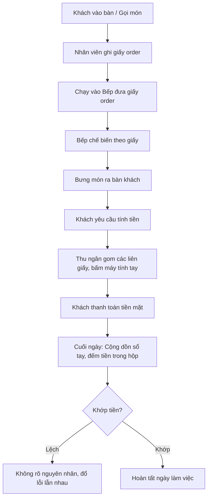
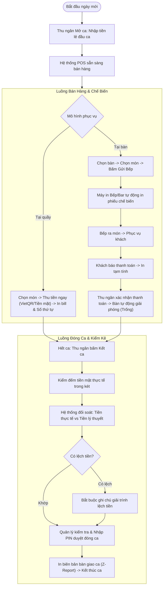

# POS Bán Hàng F&B (Quán Ăn, Cafe) — Tài liệu yêu cầu nghiệp vụ (BRD)

| Thông tin | Giá trị |
|---|---|
| Phiên bản | 0.1 · Nháp |
| Trạng thái | Nháp |
| Đầu vào | 00-intake.md v0.1 · 01-brainstorm.md v0.1 |
| Người duyệt | Chủ quán / Giám đốc điều hành F&B |

## 1. Mục đích tài liệu

Tài liệu này xác định các mục tiêu kinh doanh, phạm vi chức năng cốt lõi và tiêu chí thành công cho việc xây dựng hệ thống phần mềm POS bán hàng chuyên cho quán ăn, cafe (pos-fnb). Tài liệu làm căn cứ để đội ngũ phát triển và quản lý thống nhất phạm vi nghiệp vụ trước khi đi vào đặc tả kỹ thuật chi tiết (SRS).

## 2. Bối cảnh và vấn đề

- **Hiện trạng:** Quán vận hành theo phương thức truyền thống hoặc dùng phần mềm rời rạc: nhân viên ghi order trên giấy, chuyển tay vào bếp/quầy pha chế; tính tiền thủ công hoặc dùng máy tính tay; thu ngân cuối ngày gom hóa đơn giấy và đếm tiền vào sổ ghi chép.
- **Vấn đề:**
  - *Chậm trễ và nhầm lẫn:* Giờ cao điểm khách đông dễ bị thất lạc order, làm chậm trễ món hoặc phục vụ nhầm bàn.
  - *Thất thoát tiền mặt:* Tiền thu ngân cuối ngày hay bị lệch, khó truy cứu trách nhiệm do không có cơ chế đối soát tiền mặt đầu ca - cuối ca theo từng nhân viên.
  - *Gian lận:* Nhân viên có thể tự ý hủy món, giảm giá sau lưng khách khi khách trả tiền mặt mà chủ quán không hay biết.
  - *Tốn thời gian tổng kết:* Cuối ngày mất từ 30-45 phút để cộng sổ doanh thu, không theo dõi được tức thời món nào bán chạy, lượng tiền chuyển khoản VietQR vs tiền mặt.
- **Cơ hội:** Hiện đại hóa quy trình bán hàng bằng POS chạm/web tinh gọn, in phiếu bếp tức thì, chốt ca tự động tính độ lệch tiền mặt và cung cấp báo cáo doanh thu real-time trên mọi thiết bị.

## 3. Mục tiêu nghiệp vụ

| ID | Mục tiêu | Chỉ số đo | Hiện tại | Mục tiêu | Mốc |
|---|---|---|---|---|---|
| OBJ-01 | Tối ưu tốc độ phục vụ và thanh toán tại bàn/quầy | Thời gian trung bình từ lúc khách yêu cầu thanh toán đến khi nhận hóa đơn | ~3 - 5 phút | < 45 giây | 1 tháng sau triển khai |
| OBJ-02 | Kiểm soát chặt chẽ tiền mặt, triệt tiêu thất thoát ca | Tỷ lệ ca làm việc có sai lệch tiền mặt chưa giải trình > 20.000 VNĐ | 0.5% tổng số ca (DEC-08) | < 0.2% tổng số ca | 2 tháng sau triển khai |
| OBJ-03 | Giảm thiểu sai sót và thất lạc order Bếp/Bar | Tỷ lệ món bị hủy hoặc trả lại do nhầm lẫn/chậm trễ order | ~5% - 8% tổng đơn | < 0.5% tổng đơn | Ngay sau khi vận hành |
| OBJ-04 | Cung cấp báo cáo doanh thu tức thời và minh bạch | Thời gian tổng hợp và xem báo cáo doanh thu, chốt ca cuối ngày | 30 - 45 phút | < 2 phút | Ngay sau khi vận hành |

## 4. Phạm vi

### 4.1 Trong phạm vi (Giai đoạn 1)

- Quản lý sơ đồ bàn, khu vực và trạng thái bàn (Trống, Đang dùng, Chờ thanh toán).
- Nghiệp vụ bán hàng tại bàn (Dine-in): Gọi món nhiều đợt, ghi chú khẩu vị/topping, chuyển bàn, gộp bàn, in phiếu thanh toán tạm tính.
- Nghiệp vụ bán hàng tại quầy (Takeaway/Fast-service): Order nhanh, in số thứ tự, thu tiền ngay.
- In phiếu chế biến nhà bếp/quầy pha chế (KOT) qua mạng LAN/máy in nhiệt.
- Quản lý ca làm việc: Đăng ký tiền lẻ đầu ca, ghi nhận thu/chi vặt trong ca, kiểm kê tiền mặt thực tế khi kết ca, báo cáo độ lệch tiền, ký duyệt đóng ca.
- Quản lý nhân viên & Phân quyền: 3 vai trò (Quản lý, Thu ngân, Phục vụ); cơ chế xác thực mã PIN cho các hành động hủy món, chiết khấu bill, hủy hóa đơn.
- Phương thức thanh toán: Tiền mặt và Chuyển khoản ngân hàng (quét mã VietQR).
- Báo cáo thống kê: Doanh thu theo ca, theo nhân viên, phương thức thanh toán, danh mục món bán chạy.

### 4.2 Ngoài phạm vi

- Định lượng nguyên vật liệu chi tiết trừ kho theo công thức pha chế (BOM).
- Quản lý chuỗi đa chi nhánh tập trung (Multi-store HQ).
- Tích hợp trực tiếp các nền tảng đặt đồ ăn trực tuyến (GrabFood, ShopeeFood).

## 5. Bên liên quan

| Bên liên quan | Vai trò với sáng kiến | Quan tâm | Mức ảnh hưởng |
|---|---|---|---|
| Chủ quán / Nhà đầu tư | Tài trợ & Phê duyệt | Doanh thu, thất thoát dòng tiền, ROI hệ thống | Cao |
| Quản lý quán | Vận hành & Giám sát | Quản lý ca, phê duyệt hủy món, kiểm soát nhân viên | Cao |
| Thu ngân | Người dùng chính | Tốc độ thao tác thanh toán, in bill, khớp tiền ca | Cao |
| Nhân viên phục vụ | Người dùng | Thao tác chọn bàn, ghi order nhanh trên thiết bị | Vừa |
| Nhân viên Bếp / Bar | Tiếp nhận vận hành | Nhận phiếu order rõ ràng, đúng thứ tự, kịp giờ | Vừa |

### Ma trận trách nhiệm (RACI) - Đề xuất

| Hoạt động | R (Thực hiện) | A (Chịu trách nhiệm) | C (Tham vấn) | I (Nhận tin) |
|---|---|---|---|---|
| Duyệt yêu cầu nghiệp vụ (BRD) | BA | Chủ quán | Quản lý quán | Đội phát triển |
| Nghiệm thu quy trình mở/đóng ca | BA / Dev | Quản lý quán | Thu ngân | Chủ quán |
| Thiết lập thực đơn và giá bán | Quản lý quán | Chủ quán | Bếp trưởng/Barista | Thu ngân |
| Ký duyệt đóng ca hàng ngày | Quản lý quán | Quản lý quán | Thu ngân | Chủ quán |

## 6. Quy trình nghiệp vụ

### 6.1 Hiện trạng (As-Is: Quy trình truyền thống)

### 6.2 Mong muốn (To-Be: Quy trình chuẩn hóa với POS)

## 7. Nhu cầu nghiệp vụ mức cao

| Nhu cầu | Phục vụ mục tiêu | MoSCoW |
|---|---|---|
| Gọi món nhanh, ghi chú chi tiết và in tự động xuống Bếp/Bar qua mạng LAN | OBJ-01, OBJ-03 | Must |
| Sơ đồ bàn trực quan, đổi bàn, gộp bàn và xem trạng thái bàn tức thời | OBJ-01 | Must |
| Quy trình mở ca, ghi nhận thu/chi vặt và kiểm kê chốt ca có Quản lý phê duyệt | OBJ-02 | Must |
| Khóa bảo mật các thao tác hủy món, giảm giá và xóa hóa đơn bằng mã PIN Quản lý | OBJ-02, OBJ-03 | Must |
| Thanh toán nhanh bằng mã VietQR động/tĩnh hiển thị trên màn hình | OBJ-01 | Must |
| Hệ thống báo cáo doanh thu real-time theo ca, theo nhân viên và theo phương thức thanh toán | OBJ-04 | Must |
| Cơ chế hoạt động ngoại tuyến tạm thời (Offline-mode) khi mất kết nối Internet đột ngột | OBJ-01 | Should |

## 8. Ràng buộc, giả định, phụ thuộc

| Loại | Nội dung | Nguồn |
|---|---|---|
| Ràng buộc | Hệ thống POS phải phản hồi thao tác dưới 1 giây trong giờ cao điểm | NFR đề xuất |
| Ràng buộc | Toàn bộ dữ liệu doanh thu, ca và hóa đơn phải được bảo mật, sao lưu định kỳ | Quy định vận hành |
| Phụ thuộc | Máy in nhiệt kết nối mạng nội bộ qua cổng LAN hoặc USB | AS-03 |
| Phụ thuộc | Hệ thống ngân hàng/VietQR sẵn sàng sinh mã QR thanh toán chuẩn NAPAS247 | AS-04 |

| ID | Giả định | Nếu sai thì |
|---|---|---|
| AS-05 | Quán có mạng LAN nội bộ ổn định giữa quầy thu ngân và khu vực bếp/bar | Cần chuyển sang in qua Bluetooth hoặc dùng màn hình bếp KDS chuyên dụng |

## 9. Rủi ro nghiệp vụ

| ID | Rủi ro | Khả năng | Ảnh hưởng | Cách giảm | Người theo dõi |
|---|---|---|---|---|---|
| RSK-03 | Nhân viên cố tình không nhập đúng số tiền kiểm đếm cuối ca để che giấu thất thoát | Vừa | Cao | Quản lý phải trực tiếp đồng kiểm kê két tiền mặt khi ký duyệt đóng ca | Quản lý quán |

## 10. Lợi ích và chi phí

| Lợi ích | Cách đo | Ước tính | Nguồn |
|---|---|---|---|
| Giảm thất thoát doanh thu tiền mặt | So sánh độ lệch tiền ca trước và sau triển khai POS | Giảm 90% các vụ thất thoát không rõ nguyên nhân | Đề xuất |
| Tăng tốc độ quay vòng bàn giờ cao điểm | Đo thời gian gọi món và ra hóa đơn | Tăng 15% - 20% năng suất phục vụ | Đề xuất |
| Tiết kiệm thời gian đóng ca cuối ngày | Đo thời gian nhân viên chốt ca | Tiết kiệm ~30 phút/ngày cho quản lý và thu ngân | Đề xuất |

## 11. Tiêu chí nghiệm thu nghiệp vụ

- Thu ngân hoàn thành quy trình Mở ca $\rightarrow$ Bán hàng $\rightarrow$ Đóng ca $\rightarrow$ In báo cáo Z-Report không xảy ra lỗi gián đoạn.
- Khi gửi order tại bàn, phiếu order in ra tại Bếp/Bar đúng nội dung, nhóm món và ghi chú trong vòng 3 giây.
- Mọi thao tác hủy món đã in bếp hoặc chiết khấu trên hóa đơn đều yêu cầu nhập mã PIN Quản lý và được ghi lại đầy đủ trong báo cáo kiểm toán.
- Báo cáo doanh thu cuối ngày khớp chính xác với tổng số tiền thu được theo từng phương thức (Tiền mặt, VietQR).

## 12. Câu hỏi còn mở

| ID | Câu hỏi | Vì sao quan trọng | Hỏi ai | Trạng thái |
|---|---|---|---|---|
| OQ-07 | Số liệu nền về tỷ lệ lệch tiền mặt hiện tại của quán là bao nhiêu? | Cung cấp baseline chính xác để đo lường OBJ-02 | Chủ quán | Đã trả lời (DEC-08) |

## 13. Phê duyệt

| Vai trò | Họ tên | Quyết định | Ngày |
|---|---|---|---|
| Chủ quán / Nhà tài trợ | Đại diện Quản lý F&B | Nháp (Chờ phê duyệt) | 2026-10-20 |

## Lịch sử thay đổi

| Phiên bản | Ngày | Thay đổi | Nguồn |
|---|---|---|---|
| 0.1 | 2026-10-20 | Khởi tạo tài liệu BRD xác định mục tiêu và quy trình nghiệp vụ To-Be | 01-brainstorm.md |
