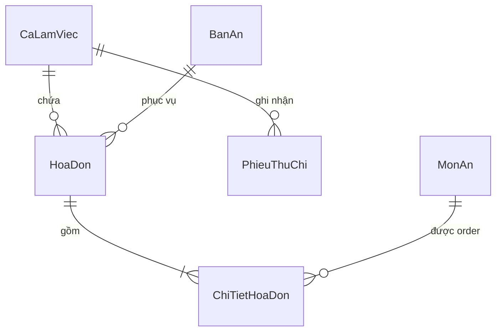
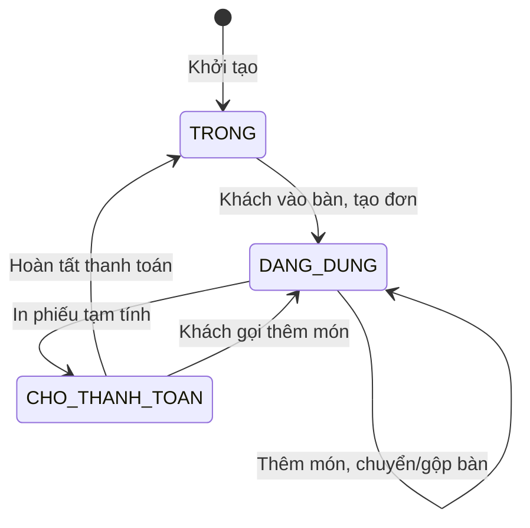
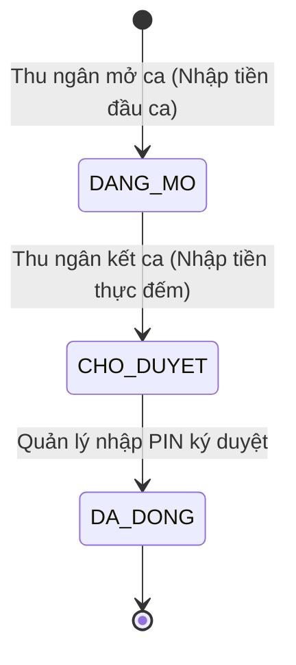

# POS Bán Hàng F&B (Quán Ăn, Cafe) — Đặc tả yêu cầu phần mềm (SRS)

| Thông tin | Giá trị |
|---|---|
| Phiên bản | 0.1 · Nháp |
| Trạng thái | Nháp |
| Đầu vào | 02-brd.md v0.1 · 01-brainstorm.md v0.1 |

## 1. Giới thiệu

### 1.1 Mục đích và phạm vi

Tài liệu này đặc tả chi tiết các yêu cầu chức năng, yêu cầu phi chức năng, ma trận phân quyền, quy tắc nghiệp vụ, ma trận lỗi và từ điển dữ liệu cho hệ thống POS Bán Hàng F&B (Quán Ăn, Cafe). Hệ thống bao phủ toàn bộ phạm vi giai đoạn 1 đã được phê duyệt trong BRD, bao gồm nghiệp vụ bán hàng tại quầy và tại bàn, quản lý ca và quỹ tiền mặt, bảo mật thao tác nhạy cảm bằng mã PIN, thanh toán VietQR và báo cáo doanh thu.

### 1.2 Thuật ngữ

| Thuật ngữ | Định nghĩa | Tên gọi khác |
|---|---|---|
| POS | Phần mềm quản trị bán hàng tại điểm bán | Point of Sale |
| KOT | Phiếu in yêu cầu chế biến gửi xuống khu vực Bếp hoặc Quầy pha chế | Kitchen Order Ticket, Phiếu bếp |
| Z-Report | Báo cáo tổng kết doanh thu và tiền mặt khi chốt ca hoặc hết ngày làm việc | Biên bản bàn giao ca |
| Cash In/Out | Nghiệp vụ nạp thêm tiền lẻ hoặc rút tiền chi trả khẩn cấp trong ca làm việc | Thu/chi vặt trong ca |
| VietQR | Chuẩn mã QR thanh toán chuyển khoản liên ngân hàng nhanh 24/7 | QR Động |

### 1.3 Tài liệu tham chiếu

- 00-intake.md: Phiếu tiếp nhận yêu cầu ban đầu.
- 01-brainstorm.md: Kết quả khơi gợi yêu cầu và các quyết định cốt lõi (DEC-01 đến DEC-04).
- 02-brd.md: Tài liệu yêu cầu nghiệp vụ và các mục tiêu kinh doanh (OBJ-01 đến OBJ-04).

## 2. Mô tả chung

### 2.1 Bối cảnh sản phẩm

Hệ thống POS bán hàng hoạt động như trung tâm điều hành vận hành tại quán ăn, cafe, kết nối nhân viên phục vụ, nhân viên thu ngân và khu vực bếp/bar, đồng thời giao tiếp trực tiếp với máy in nhiệt qua mạng nội bộ LAN và hiển thị mã VietQR thanh toán cho khách.

### 2.2 Nhóm người dùng và tác nhân

| Tác nhân | Loại | Mục tiêu | Quyền chính |
|---|---|---|---|
| Chủ quán / Quản lý | Người | Giám sát toàn diện, kiểm soát quỹ tiền mặt, xem báo cáo, phê duyệt | Toàn quyền cấu hình, xem báo cáo, cấp và nhập PIN duyệt thao tác nhạy cảm |
| Thu ngân | Người | Mở/đóng ca, thanh toán, in hóa đơn, ghi nhận thu chi vặt | Bán hàng tại quầy và tại bàn, quản lý ca của chính mình |
| Nhân viên phục vụ | Người | Xem sơ đồ bàn, gọi món, ghi chú, chuyển/gộp bàn | Thao tác trên bàn và đơn hàng, không được tự ý xóa hoặc giảm giá |
| Bếp / Quầy Bar | Người | Nhận phiếu order chế biến, biết bàn và thời gian | Xem phiếu in KOT, báo hết món |
| Máy in nhiệt | Hệ thống ngoài | Nhận lệnh in phiếu chế biến và hóa đơn qua mạng LAN/USB | In tự động theo lệnh từ POS |

### 2.3 Môi trường vận hành

- Thiết bị: Máy tính PC để bàn (màn hình thường hoặc cảm ứng), máy POS cảm ứng chuyên dụng chạy Windows/Android, hoặc máy tính bảng Tablet (iPad/Android).
- Trình duyệt & Ứng dụng: Chạy mượt trên các trình duyệt hiện đại (Google Chrome, Microsoft Edge) hoặc Web-App nhúng.
- Mạng: Mạng cục bộ LAN kết nối POS với máy in nhiệt; mạng Internet để đồng bộ dữ liệu doanh thu lên máy chủ đám mây.
- Giờ hệ thống: Múi giờ Việt Nam (GMT+7).

### 2.4 Ràng buộc thiết kế và cài đặt

- Giao diện bán hàng tối ưu cho thao tác chạm (Touch-friendly): Các nút bấm to, rõ, thao tác thêm món không quá 2 chạm.
- Chế độ bán hàng ngoại tuyến: Nếu mất kết nối Internet đột ngột, POS vẫn cho phép order và in bill nội bộ trong mạng LAN, lưu trữ cục bộ và đồng bộ khi có mạng.

### 2.5 Ma trận phân quyền

| Hành động | Quản lý quán | Thu ngân | Nhân viên phục vụ | Nguồn |
|---|---|---|---|---|
| Xem sơ đồ bàn và trạng thái bàn | Có | Có | Có | FR-01 |
| Tạo đơn gọi món và thêm món tại bàn | Có | Có | Có | FR-02 |
| Gửi lệnh in phiếu chế biến Bếp/Bar | Có | Có | Có | FR-03 |
| Chuyển bàn, gộp bàn | Có | Có | Có | FR-04 |
| Tạo đơn bán hàng nhanh tại quầy | Có | Có | Không | FR-05 |
| Hủy món đã gửi bếp (Cần PIN) | Có | Cần PIN Quản lý | Cần PIN Quản lý | FR-10 |
| Giảm giá, chiết khấu hóa đơn (Cần PIN) | Có | Cần PIN Quản lý | Không | FR-10 |
| Hủy hóa đơn đã tạo (Cần PIN) | Có | Cần PIN Quản lý | Không | FR-10 |
| In phiếu tạm tính hóa đơn | Có | Có | Có | FR-13 |
| Thực hiện thanh toán và in bill cuối | Có | Có | Không | FR-11, FR-12 |
| Mở ca làm việc (Nhập tiền lẻ) | Có | Của mình | Không | FR-06 |
| Ghi nhận thu/chi vặt tiền mặt trong ca | Có | Của mình | Không | FR-07 |
| Kết ca kiểm đếm tiền thực tế | Có | Của mình | Không | FR-08 |
| Ký duyệt đóng ca làm việc | Có | Không | Không | FR-09 |
| Xem báo cáo doanh thu tổng hợp | Có | Không | Không | FR-14 |
| Xem doanh thu trong ca của chính mình | Có | Của mình | Không | FR-14 |
| Quản lý thực đơn, nhóm món, giá bán | Có | Không | Không | FR-15 |

## 3. Yêu cầu chức năng

| ID | Yêu cầu | Ưu tiên | Kiểm chứng bằng | Nguồn |
|---|---|---|---|---|
| FR-01 | Hệ thống phải hiển thị sơ đồ bàn theo từng khu vực với màu sắc trực quan tương ứng với 3 trạng thái: Bàn trống (xanh lá), Đang phục vụ (đỏ), và Chờ thanh toán (vàng). | Must | Demo | OBJ-01, DEC-01 |
| FR-02 | Hệ thống phải cho phép chọn bàn, chọn món từ danh mục, chọn món ăn kèm (topping) và nhập ghi chú chế biến cụ thể cho từng món. | Must | Test | OBJ-01, DEC-01 |
| FR-03 | Hệ thống phải tự động gửi lệnh in phiếu chế biến (KOT) xuống máy in Bếp/Bar tương ứng (tách 2 máy in Bar và Bếp độc lập) ngay khi nhân viên bấm nút Gửi Bếp. | Must | Test | OBJ-03, AS-03, DEC-07 |
| FR-04 | Hệ thống phải hỗ trợ chuyển toàn bộ món từ bàn này sang bàn trống khác, hoặc gộp hai hay nhiều bàn đang phục vụ thành một hóa đơn chung. | Must | Test | OBJ-01, DEC-01 |
| FR-05 | Hệ thống phải cung cấp giao diện bán mang về / tại quầy cho phép chọn món, chọn thanh toán ngay, in số thứ tự và in hóa đơn thanh toán trong một luồng liền mạch. | Must | Test | OBJ-01, DEC-01 |
| FR-06 | Hệ thống phải yêu cầu nhân viên thu ngân nhập số tiền mặt đầu ca (tiền lẻ thối) và ghi nhận thời điểm mở ca trước khi cho phép thực hiện bất kỳ giao dịch bán hàng nào. | Must | Test | OBJ-02, DEC-02 |
| FR-07 | Hệ thống phải cho phép thu ngân ghi nhận các khoản thu vặt hoặc chi vặt tiền mặt khẩn cấp trong ca kèm số tiền, lý do chi và người nhận/nộp. | Should | Test | OBJ-02, DEC-02 |
| FR-08 | Hệ thống phải cho phép thu ngân nhập số tiền mặt kiểm đếm thực tế khi kết ca và tự động tính toán độ lệch so với số liệu tính toán lý thuyết của hệ thống. | Must | Test | OBJ-02, DEC-02 |
| FR-09 | Hệ thống phải yêu cầu Quản lý xác nhận và nhập mã PIN để ký duyệt đóng ca, sau đó in biên bản bàn giao ca (Z-Report) và khóa phiên làm việc. | Must | Test | OBJ-02, DEC-02 |
| FR-10 | Hệ thống phải yêu cầu xác thực mã PIN của Quản lý khi thực hiện các thao tác: hủy món đã gửi bếp, áp dụng chiết khấu/giảm giá trên hóa đơn, hoặc xóa/hủy đơn hàng. | Must | Test | OBJ-02, DEC-03 |
| FR-11 | Hệ thống phải hỗ trợ thanh toán tiền mặt, tự động tính số tiền thối lại cho khách dựa trên số tiền khách đưa và in hóa đơn hoàn tất. | Must | Test | OBJ-01, DEC-01 |
| FR-12 | Hệ thống phải tạo và hiển thị mã VietQR động chứa chính xác số tiền cần thanh toán và mã hóa đơn, đồng thời tự động nhận webhook từ cổng SePay để hoàn tất đơn hàng tức thì. | Must | Test | OBJ-01, AS-04, DEC-06 |
| FR-13 | Hệ thống phải cho phép in phiếu tạm tính cho khách kiểm tra trước khi thanh toán và in hóa đơn tài chính cuối cùng sau khi thanh toán thành công. | Must | Test | OBJ-01, AS-02 |
| FR-14 | Hệ thống phải cung cấp báo cáo doanh thu theo ca làm việc, theo nhân viên bán hàng, theo phương thức thanh toán và thống kê các món bán chạy nhất trong ngày. | Must | Test | OBJ-04, DEC-04 |
| FR-15 | Hệ thống phải cho phép Quản lý tạo, cập nhật thông tin món ăn, hình ảnh, đơn giá, danh mục nhóm món và bật/tắt trạng thái hết món tức thời. | Must | Demo | OBJ-01, DEC-01 |

## 4. Yêu cầu phi chức năng

| ID | Nhóm (ISO/IEC 25010:2011) | Yêu cầu | Ngưỡng đo | Nguồn |
|---|---|---|---|---|
| NFR-01 | Hiệu năng (Performance) | Thời gian phản hồi thao tác thêm món, đổi trạng thái bàn trên giao diện POS | Dưới 0.5 giây | OBJ-01 |
| NFR-02 | Hiệu năng (Performance) | Thời gian từ lúc bấm Gửi Bếp đến khi phiếu in KOT xuất hiện tại máy in bếp qua mạng LAN | Dưới 2.5 giây | OBJ-03 |
| NFR-03 | Bảo mật (Security) | Độ dài mã PIN phê duyệt của Quản lý và cơ chế khóa tạm thời nếu nhập sai liên tiếp | 4 đến 6 chữ số; khóa 5 phút nếu sai quá 5 lần | DEC-03, BR-04 |
| NFR-04 | Tin cậy (Reliability) | Tự động lưu trữ đơn hàng cục bộ khi mất kết nối mạng và tự động đồng bộ ngầm ngay khi có mạng trở lại | Không mất mát bất kỳ đơn hàng nào đã order | RSK-01, DEC-10 |
| NFR-05 | Khả dụng (Usability) | Nhân viên mới có thể nắm bắt và thao tác bán hàng cơ bản tại bàn sau thời gian hướng dẫn | Dưới 30 phút đào tạo | DEC-09 |
| NFR-06 | Tương thích (Compatibility) | Hỗ trợ in chuẩn lệnh ESC/POS trên các khổ giấy nhiệt thông dụng | Khổ 80mm và khổ 58mm | AS-03 |

## 5. Quy tắc nghiệp vụ

| ID | Quy tắc | Khi nào áp dụng | Dùng ở | Nguồn |
|---|---|---|---|---|
| BR-01 | Không được phép bán hàng khi chưa có ca làm việc nào đang mở. Thu ngân bắt buộc phải hoàn tất bước nhập tiền đầu ca để mở ca. | Khi bắt đầu ngày mới hoặc ca mới | FR-06 | DEC-02 |
| BR-02 | Bàn đang có khách (Đang phục vụ hoặc Chờ thanh toán) không được phép xếp khách mới đè lên, trừ khi thực hiện thao tác gộp bàn. | Khi chọn bàn tạo đơn | FR-01, FR-04 | DEC-01 |
| BR-03 | Hủy món sau khi đã gửi bếp bắt buộc phải nhập lý do hủy (tối thiểu 5 ký tự) và phải có mã PIN xác thực của Quản lý. | Khi thao tác hủy món | FR-10 | DEC-03 |
| BR-04 | Mã PIN Quản lý bị khóa 5 phút nếu nhập sai liên tiếp 5 lần để phòng chống dò mã. | Khi xác thực mã PIN | FR-10 | NFR-03 |
| BR-05 | Tiền mặt lý thuyết cuối ca được tính tự động theo công thức: Tiền mặt lý thuyết = Tiền đầu ca + Tiền mặt thu bán hàng + Thu vặt - Chi vặt. | Khi kết ca | FR-08 | DEC-02 |
| BR-06 | Nếu tiền mặt thực tế kiểm đếm lệch so với tiền mặt lý thuyết (> 0 VNĐ dù thừa hay thiếu), hệ thống bắt buộc nhân viên nhập giải trình lý do lệch. | Khi kết ca | FR-08 | DEC-02 |
| BR-07 | Không được phép đóng ca khi vẫn còn hóa đơn bàn đang phục vụ chưa hoàn tất thanh toán hoặc chưa được chuyển sang ca tiếp theo. | Khi bấm kết ca | FR-08, FR-09 | DEC-02 |
| BR-08 | Hóa đơn đã hoàn tất thanh toán không được phép sửa đổi trực tiếp; nếu có sai sót bắt buộc phải thực hiện quy trình hủy hóa đơn có mã PIN Quản lý. | Sau khi thanh toán | FR-10, FR-11 | DEC-03 |
| BR-09 | Không được phép gọi hoặc thêm món ăn đang ở trạng thái hết hàng (hết nguyên liệu chế biến). | Khi chọn món gọi | FR-02, FR-15 | DEC-01 |
| BR-10 | Đơn hàng tại quầy bắt buộc phải có ít nhất 1 món ăn với tổng số tiền lớn hơn 0 trước khi chuyển sang bước thanh toán. | Khi bấm thanh toán quầy | FR-05 | DEC-01 |
| BR-11 | Giao dịch tạo mã VietQR có thời gian chờ quét tối đa 3 phút. Nếu quá thời gian, hệ thống tự động làm mới mã QR hoặc chuyển sang thanh toán tiền mặt. | Khi chờ khách quét QR | FR-12 | AS-04 |
| BR-12 | Khi in hóa đơn, nếu máy in hết giấy hoặc bị kẹt giấy, hệ thống lưu trạng thái đơn đã thanh toán và cho phép bấm nút In lại hóa đơn. | Khi in hóa đơn | FR-13 | AS-02 |
| BR-13 | Bộ lọc xem báo cáo doanh thu không cho phép ngày bắt đầu lớn hơn ngày kết thúc. | Khi tra cứu báo cáo | FR-14 | DEC-04 |
| BR-14 | Khi tạo hoặc sửa món ăn, đơn giá bán bắt buộc phải lớn hơn hoặc bằng 0 VNĐ và tên món không được để trống. | Khi quản lý thực đơn | FR-15 | DEC-01 |

## 6. Ma trận lỗi

| ID | Tình huống | Thông báo cho người dùng (nguyên văn) | Mức | Cách khắc phục | Liên quan |
|---|---|---|---|---|---|
| ERR-01 | Thu ngân cố gắng bán hàng khi chưa mở ca | "Ca làm việc chưa được mở. Vui lòng mở ca và nhập số dư tiền mặt đầu ca để bắt đầu." | Chặn | Điều hướng thu ngân về màn hình Mở ca | FR-06, BR-01 |
| ERR-02 | Nhập sai mã PIN Quản lý khi duyệt thao tác nhạy cảm | "Mã PIN phê duyệt không chính xác. Vui lòng kiểm tra lại!" | Chặn | Yêu cầu nhập lại mã PIN đúng | FR-10, BR-04 |
| ERR-03 | Nhập sai mã PIN Quản lý quá 5 lần liên tiếp | "Bạn đã nhập sai mã PIN quá 5 lần. Chức năng xác thực bị khóa tạm thời trong 5 phút!" | Chặn | Chờ hết 5 phút hoặc dùng tài khoản Quản lý cấp cao mở khóa | FR-10, BR-04 |
| ERR-04 | Cố gắng kết ca khi vẫn còn bàn chưa thanh toán | "Không thể đóng ca! Vẫn còn {so_luong_ban} bàn chưa hoàn tất thanh toán. Vui lòng thanh toán hoặc bàn giao bàn." | Chặn | Thanh toán hết các bàn đang phục vụ trước khi đóng ca | FR-08, BR-07 |
| ERR-05 | Lệch tiền mặt cuối ca mà không nhập lý do | "Tiền mặt thực tế bị lệch {so_tien_lech} VNĐ. Vui lòng nhập lý do giải trình để tiếp tục!" | Chặn | Nhập lý do giải trình vào ô ghi chú | FR-08, BR-06 |
| ERR-06 | Mất kết nối tới máy in Bếp/Bar qua mạng LAN | "Không thể kết nối tới máy in bếp. Vui lòng kiểm tra nguồn điện và dây mạng của máy in!" | Cảnh báo | Kiểm tra máy in và bấm nút Thử in lại | FR-03, AS-03 |
| ERR-07 | Chọn món ăn đã được đánh dấu hết hàng | "Món {ten_mon} hiện đã hết. Vui lòng chọn món khác!" | Chặn | Chọn món thay thế hoặc báo khách đổi món | FR-02, BR-09 |
| ERR-08 | Bấm thanh toán đơn tại quầy khi giỏ hàng chưa có món | "Đơn hàng chưa có món ăn. Vui lòng chọn món trước khi thanh toán!" | Chặn | Chọn ít nhất một món vào đơn hàng | FR-05, BR-10 |
| ERR-09 | Quá thời gian chờ quét mã thanh toán VietQR | "Hết thời gian chờ thanh toán VietQR. Vui lòng tạo mã QR mới hoặc thanh toán tiền mặt!" | Cảnh báo | Bấm tạo lại mã QR hoặc chọn phương thức tiền mặt | FR-12, BR-11 |
| ERR-10 | Máy in hóa đơn bị kẹt giấy hoặc hết giấy | "Máy in hóa đơn hết giấy hoặc bị kẹt. Vui lòng kiểm tra giấy và in lại!" | Cảnh báo | Nạp thêm cuộn giấy nhiệt và bấm nút In lại bill | FR-13, BR-12 |
| ERR-11 | Chọn khoảng ngày lọc báo cáo doanh thu không hợp lệ | "Ngày bắt đầu không được lớn hơn ngày kết thúc!" | Chặn | Chọn lại khoảng thời gian lọc hợp lệ | FR-14, BR-13 |
| ERR-12 | Nhập giá bán món ăn nhỏ hơn 0 VNĐ | "Đơn giá món ăn không được nhỏ hơn 0 VNĐ!" | Chặn | Nhập giá bán món ăn hợp lệ | FR-15, BR-14 |

## 7. Dữ liệu nghiệp vụ

### 7.1 Thực thể

| Thực thể | Mục đích | Thuộc tính nghiệp vụ chính | Quan hệ |
|---|---|---|---|
| CaLamViec | Quản lý phiên làm việc, thời gian và tiền mặt thu ngân | MaCa, NhanVienId, GioMo, GioDong, TienDauCa, TienCuoiCaThucTe, TienLyThuyet, DoLech, GiaiTrinh, TrangThai | 1 CaLamViec có nhiều HoaDon và PhieuThuChi |
| BanAn | Đại diện bàn vật lý trong quán | MaBan, TenBan, KhuVucId, SucChua, TrangThai | 1 BanAn gắn với 0 hoặc 1 HoaDon đang phục vụ |
| MonAn | Danh mục món ăn, thức uống | MaMon, TenMon, DanhMucId, DonGia, DonViTinh, DangKinhDoanh | 1 MonAn thuộc 1 DanhMuc, xuất hiện trong nhiều ChiTietHoaDon |
| HoaDon | Đơn hàng bán tại bàn hoặc tại quầy | MaHoaDon, LoaiDon, BanId, CaLamViecId, TongTien, GiamGia, KhachCanTra, PhuongThucTT, TrangThai, GioTao | 1 HoaDon có nhiều ChiTietHoaDon |
| ChiTietHoaDon | Từng dòng món ăn trong hóa đơn | MaChiTiet, HoaDonId, MonAnId, SoLuong, DonGia, GhiChu, DaInBep, DaHuy, LyDoHuy | Thuộc 1 HoaDon và 1 MonAn |
| PhieuThuChi | Khoản nạp/rút tiền mặt trong ca | MaPhieu, CaLamViecId, LoaiPhieu, SoTien, LyDo, NguoiThucHien | Thuộc 1 CaLamViec |

### 7.2 Từ điển dữ liệu

| Trường | Kiểu | Bắt buộc | Ràng buộc / định dạng | Ví dụ (giả lập) | Cá nhân | Nguồn |
|---|---|---|---|---|---|---|
| CaLamViec.MaCa | Chuỗi(20) | Có | Định dạng CA-YYYYMMDD-nn | CA-20261020-01 | Không | FR-06 |
| CaLamViec.TienDauCa | Tiền (VND) | Có | Lớn hơn hoặc bằng 0 | 1000000 | Không | FR-06 |
| CaLamViec.TienCuoiCaThucTe | Tiền (VND) | Có | Lớn hơn hoặc bằng 0 | 5450000 | Không | FR-08 |
| CaLamViec.TienLyThuyet | Tiền (VND) | Có | Tính theo công thức BR-05 | 5500000 | Không | FR-08, BR-05 |
| CaLamViec.DoLech | Tiền (VND) | Có | TiềnCuốiCaThựcTế - TiềnLýThuyết | -50000 | Không | FR-08, BR-06 |
| CaLamViec.GiaiTrinh | Chuỗi(255) | Không | Bắt buộc nếu ĐộLệch khác 0 | "Thối nhầm tiền cho bàn 3" | Không | FR-08, BR-06, ERR-05 |
| CaLamViec.TrangThai | Một trong: DANG_MO \| CHO_DUYET \| DA_DONG | Có | Theo quy trình ca | DANG_MO | Không | FR-06, FR-09 |
| BanAn.TenBan | Chuỗi(50) | Có | Tên duy nhất theo khu vực | "Bàn 04 - Tầng 1" | Không | FR-01 |
| BanAn.TrangThai | Một trong: TRONG \| DANG_DUNG \| CHO_THANH_TOAN | Có | Vòng đời bàn ăn | DANG_DUNG | Không | FR-01, BR-02 |
| HoaDon.MaHoaDon | Chuỗi(20) | Có | Định dạng HD-YYYYMMDD-nnnn | HD-20261020-0042 | Không | FR-02, FR-05 |
| HoaDon.LoaiDon | Một trong: TAI_BAN \| MANG_VE | Có | Mô hình phục vụ | TAI_BAN | Không | FR-01, FR-05 |
| HoaDon.TongTien | Tiền (VND) | Có | Lớn hơn 0 | 250000 | Không | FR-02, BR-10 |
| HoaDon.GiamGia | Tiền (VND) | Có | Lớn hơn hoặc bằng 0 | 25000 | Không | FR-10 |
| HoaDon.KhachCanTra | Tiền (VND) | Có | TổngTiền - GiảmGiá | 225000 | Không | FR-11 |
| HoaDon.PhuongThucTT | Một trong: TIEN_MAT \| VIETQR | Có | Kênh thanh toán | VIETQR | Không | FR-11, FR-12 |
| HoaDon.TrangThai | Một trong: DANG_PHUC_VU \| DA_THANH_TOAN \| DA_HUY | Có | Trạng thái hóa đơn | DA_THANH_TOAN | Không | FR-02, FR-11 |
| ChiTietHoaDon.SoLuong | Số nguyên | Có | Lớn hơn 0 | 2 | Không | FR-02 |
| ChiTietHoaDon.GhiChu | Chuỗi(100) | Không | Ghi chú khẩu vị khách | "Ít ngọt, nhiều đá" | Không | FR-02 |
| ChiTietHoaDon.LyDoHuy | Chuỗi(255) | Không | Tối thiểu 5 ký tự nếu hủy món | "Khách đổi ý sang trà đào" | Không | FR-10, BR-03 |
| MonAn.DonGia | Tiền (VND) | Có | Lớn hơn hoặc bằng 0 VNĐ | 45000 | Không | FR-15, BR-14, ERR-12 |
| MonAn.DangKinhDoanh | Một trong: DANG_BAN \| HET_HANG | Có | Trạng thái món | DANG_BAN | Không | FR-15, BR-09, ERR-07 |

## 8. Trạng thái

### 8.1 Vòng đời Bàn ăn

### 8.2 Vòng đời Ca làm việc

## 9. Giao tiếp bên ngoài

| Hệ thống | Hướng | Dữ liệu trao đổi | Khi nào | Lỗi thì sao |
|---|---|---|---|---|
| Máy in nhiệt KOT (Bếp/Bar) | Ra | Lệnh in ESC/POS, danh sách món, số lượng, ghi chú, mã bàn | Khi nhân viên bấm nút Gửi Bếp | Báo lỗi ERR-06 lên màn hình POS, lưu lại lệnh để thử in lại |
| Máy in nhiệt Hóa đơn | Ra | Lệnh in ESC/POS, thông tin hóa đơn, tổng tiền, thuế/giảm giá | Khi in tạm tính hoặc in bill thanh toán | Báo lỗi ERR-10, cho phép chọn in lại sau khi sửa giấy/mực |
| Cổng VietQR | Ra/Vào | Thông tin tài khoản ngân hàng, mã đơn, số tiền $\rightarrow$ Chuỗi mã QR chuẩn NAPAS247 | Khi chọn phương thức thanh toán VietQR | Nếu quá thời gian báo lỗi ERR-09; nếu mất mạng chuyển sang mã VietQR tĩnh |

## 10. Triển khai và chuyển đổi dữ liệu

| Hạng mục | Nội dung | Nguồn |
|---|---|---|
| Bật tắt tính năng (feature flag) | Có cờ cấu hình cho phép bật/tắt yêu cầu nhập mã PIN khi giảm giá hoặc hủy món | Đề xuất |
| Cách ra mắt | Triển khai chạy thử nghiệm 3 ngày song song với sổ tay tại 1 cơ sở trước khi chuyển hẳn | Đề xuất |
| Dữ liệu cũ | Nhập sẵn danh mục thực đơn (món ăn, đồ uống, giá niêm yết) từ file Excel chuẩn trước ngày go-live | Đề xuất |
| Người dùng đang dở thao tác | Khi cập nhật phần mềm hoặc chuyển ca, các bàn đang dùng vẫn giữ nguyên trạng thái | NFR-04 |
| Quay lui (rollback) | Nếu hệ thống gặp sự cố trong 24 giờ đầu, sử dụng dữ liệu hóa đơn giấy dự phòng | Đề xuất |

## 11. Đo lường sau khi ra mắt

| Sự kiện | Khi nào ghi | Thuộc tính | Đo cho | Nguồn |
|---|---|---|---|---|
| ca_lam_viec_da_dong | Khi Quản lý ký duyệt đóng ca thành công | MaCa, NhanVienId, DoLechTien, ThoiGianCa | OBJ-02 | FR-09, BR-05 |
| hoa_don_da_thanh_toan | Khi giao dịch thanh toán hoàn tất | MaHoaDon, TongTien, PhuongThucTT, ThoiGianPhucVuGiay | OBJ-01, OBJ-04 | FR-11, FR-12 |
| phieu_bep_da_in | Khi máy in bếp xác nhận in xong KOT | MaHoaDon, MaBan, ThoiGianInGiay | OBJ-03 | FR-03 |
| thao_tac_nhay_cam_da_duyet | Khi Quản lý nhập PIN duyệt hủy món/giảm giá | LoaiThaoTac, MaHoaDon, LyDo, QuanLyId | OBJ-02 | FR-10 |

## 12. Truy vết mục tiêu → yêu cầu

- OBJ-01 (Tốc độ phục vụ): Được phủ bởi FR-01, FR-02, FR-04, FR-05, FR-11, FR-12, FR-13, FR-15.
- OBJ-02 (Kiểm soát tiền mặt & Chống thất thoát): Được phủ bởi FR-06, FR-07, FR-08, FR-09, FR-10.
- OBJ-03 (Chính xác Bếp/Bar): Được phủ bởi FR-03, FR-10.
- OBJ-04 (Báo cáo doanh thu tức thời): Được phủ bởi FR-14.

## 13. Câu hỏi còn mở

| ID | Câu hỏi | Vì sao quan trọng | Hỏi ai | Trạng thái |
|---|---|---|---|---|
| OQ-08 | Có cần cấu hình phân luồng tự động món nước ra máy in Bar và món ăn ra máy in Bếp độc lập không? | Ảnh hưởng đến logic định tuyến lệnh in KOT ở FR-03 | Quản lý quán | Đã trả lời (DEC-07) |
| OQ-09 | Thời gian đào tạo nhân viên mới tối đa mong muốn là bao nhiêu phút để đo lường NFR-05? | Xác lập tiêu chí nghiệm thu NFR-05 | Chủ quán | Đã trả lời (DEC-09) |
| OQ-10 | Khi mất mạng Internet và có lại, hệ thống nên tự động đồng bộ ngầm (background auto-sync) hay cần nút xác nhận đồng bộ? | Quyết định kiến trúc background sync và trải nghiệm người dùng khi vận hành ngoại tuyến | Chủ quán | Đã trả lời (DEC-10) |
| OQ-11 | Két đựng tiền mặt tại quầy (RJ12) sẽ tự động bật mở trong những tình huống nào? | Đảm bảo an toàn quỹ tiền mặt tại quầy và thiết lập lệnh kích xung điện RJ12 | Chủ quán | Đã trả lời (DEC-11) |
| OQ-12 | Sau khi hóa đơn đã thanh toán và in bill, Quản lý được phép hủy hóa đơn (Void bill) trong khung thời gian nào? | Quyết định tính toàn vẹn của dữ liệu doanh thu và giới hạn thời gian cho quyền hủy bill của Quản lý | Chủ quán | Đã trả lời (DEC-12) |
| OQ-13 | Mẫu in hóa đơn giao khách (khổ nhiệt 80mm/58mm) có yêu cầu in kèm Logo quán và mã QR Wi-Fi miễn phí không? | Quyết định cấu hình in đồ họa ESC/POS (in ảnh đồ họa bitmap) và các trường thông số chân bill | Chủ quán | Đã trả lời (DEC-13) |
| OQ-14 | Khi Quản lý duyệt chốt ca (Z-Report), Chủ quán có nhu cầu nhận tin nhắn tóm tắt doanh thu tức thời qua Telegram/Zalo Bot không? | Xác định nhu cầu xây dựng webhook gửi tin nhắn tự động ngoài báo cáo trên màn hình POS | Chủ quán | Đã trả lời (DEC-14) |

## Lịch sử thay đổi

| Phiên bản | Ngày | Thay đổi | Nguồn |
|---|---|---|---|
| 0.1 | 2026-10-20 | Khởi tạo tài liệu đặc tả yêu cầu phần mềm SRS chi tiết bao phủ các mục tiêu BRD | 02-brd.md |
