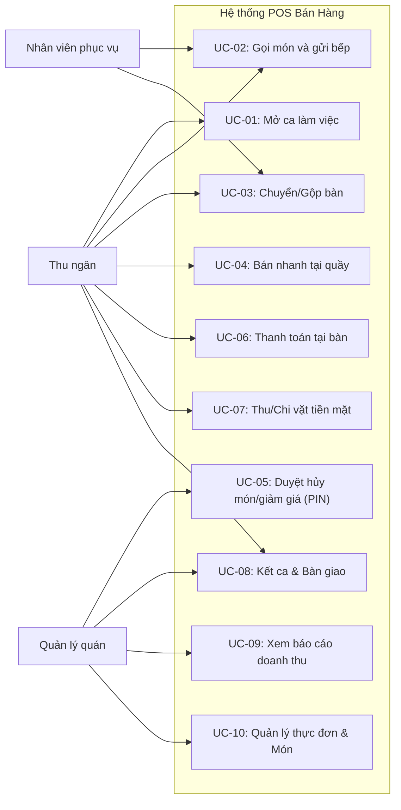

# POS Bán Hàng F&B (Quán Ăn, Cafe) — Đặc tả use case

| Thông tin | Giá trị |
|---|---|
| Phiên bản | 0.1 · Nháp |
| Đầu vào | 03-srs.md v0.1 |

## Danh mục use case

| ID | Tên | Tác nhân chính | Mức | FR liên quan | Ưu tiên |
|---|---|---|---|---|---|
| UC-01 | Mở ca làm việc | Thu ngân | Mục tiêu người dùng | FR-06 | Must |
| UC-02 | Gọi món và gửi bếp tại bàn | Nhân viên phục vụ, Thu ngân, Bếp / Quầy Bar | Mục tiêu người dùng | FR-01, FR-02, FR-03 | Must |
| UC-03 | Chuyển bàn hoặc gộp bàn | Nhân viên phục vụ, Thu ngân | Mục tiêu người dùng | FR-01, FR-04 | Must |
| UC-04 | Bán hàng nhanh tại quầy | Thu ngân | Mục tiêu người dùng | FR-05, FR-11, FR-12, FR-13 | Must |
| UC-05 | Phê duyệt hủy món hoặc giảm giá | Chủ quán / Quản lý, Thu ngân | Chức năng con | FR-10 | Must |
| UC-06 | Thanh toán hóa đơn tại bàn | Thu ngân | Mục tiêu người dùng | FR-01, FR-11, FR-12, FR-13 | Must |
| UC-07 | Ghi nhận thu chi vặt trong ca | Thu ngân | Mục tiêu người dùng | FR-07 | Should |
| UC-08 | Kết ca và kiểm kê tiền mặt | Thu ngân, Chủ quán / Quản lý | Mục tiêu người dùng | FR-08, FR-09 | Must |
| UC-09 | Tra cứu báo cáo doanh thu | Chủ quán / Quản lý | Mục tiêu người dùng | FR-14 | Must |
| UC-10 | Quản lý thực đơn và trạng thái món | Chủ quán / Quản lý | Mục tiêu người dùng | FR-15 | Must |

---

### UC-01 Mở ca làm việc

| Mục | Nội dung |
|---|---|
| Tác nhân chính | Thu ngân |
| Bên liên quan và quan tâm | Quản lý (muốn biết chính xác tiền lẻ tồn két đầu ca), Thu ngân (muốn ghi nhận rõ trách nhiệm tài chính ca làm của mình) |
| Kích hoạt | Thu ngân đăng nhập vào hệ thống khi bắt đầu ngày hoặc ca làm việc mới |
| Điều kiện trước | Chưa có ca làm việc nào đang mở thuộc nhân viên này; hệ thống sẵn sàng hoạt động |
| Bảo đảm tối thiểu | Không cho phép tạo bất kỳ giao dịch bán hàng nào nếu ca chưa mở thành công |
| Bảo đảm khi thành công | Phiên ca làm việc mới được tạo ở trạng thái Đang mở; số tiền mặt đầu ca được ghi nhận; chuyển sang giao diện bán hàng |
| Yêu cầu liên quan | FR-06 · BR-01 · ERR-01 |

**Luồng chính**

1. Thu ngân chọn chức năng Bắt đầu ca làm việc trên màn hình.
2. Hệ thống hiển thị hộp thoại Mở ca làm việc, yêu cầu nhập số tiền mặt lẻ đầu ca.
3. Thu ngân đếm tiền trong két và nhập số tiền mặt khởi tạo ca (ví dụ: 1.000.000 VNĐ).
4. Thu ngân bấm nút Xác nhận mở ca.
5. Hệ thống ghi nhận bản ghi Ca làm việc mới với trạng thái Đang mở và thời gian mở ca.
6. Hệ thống chuyển hướng người dùng sang màn hình Sơ đồ bàn để sẵn sàng bán hàng.

**Luồng mở rộng**

- 3a. Thu ngân nhập số tiền âm hoặc ký tự không hợp lệ: Hệ thống hiển thị thông báo Số tiền đầu ca phải lớn hơn hoặc bằng 0; quay về bước 3.
- 5a. Hệ thống phát hiện nhân viên đang có một ca khác chưa đóng: Hệ thống báo lỗi và mở lại ca đang dở; kết thúc use case.

---

### UC-02 Gọi món và gửi bếp tại bàn

| Mục | Nội dung |
|---|---|
| Tác nhân chính | Nhân viên phục vụ, Thu ngân |
| Bên liên quan và quan tâm | Khách hàng (nhận món đúng yêu cầu), Bếp/Bar (nhận thông tin rõ ràng, kịp thời), Quản lý (không thất thoát món) |
| Kích hoạt | Khách hàng vào bàn và gọi món ăn, đồ uống |
| Điều kiện trước | Ca làm việc đang mở; bàn ăn tồn tại trên hệ thống |
| Bảo đảm tối thiểu | Nếu in bếp thất bại, đơn hàng vẫn được lưu trên POS kèm thông báo để thử in lại |
| Bảo đảm khi thành công | Đơn hàng được gắn vào bàn; bàn chuyển sang màu đỏ (Đang dùng); máy in Bếp/Bar in phiếu KOT thành công |
| Yêu cầu liên quan | FR-01 · FR-02 · FR-03 · BR-02 · BR-09 · ERR-06 · ERR-07 |

**Luồng chính**

1. Nhân viên chọn bàn ăn trên Sơ đồ bàn (bàn đang màu xanh lá: Bàn trống).
2. Hệ thống mở giao diện gọi món cho bàn đã chọn.
3. Nhân viên chọn các món ăn từ danh mục thực đơn, chọn món ăn kèm (topping) và nhập ghi chú (ví dụ: không đá, ít đường).
4. Hệ thống cập nhật danh sách món, số lượng và tạm tính tổng tiền đơn hàng.
5. Nhân viên bấm nút Gửi Bếp.
6. Hệ thống lưu các món vào Hóa đơn, cập nhật trạng thái bàn sang Đang dùng (màu đỏ).
7. Hệ thống tự động phát lệnh in phiếu chế biến KOT xuống máy in tại khu vực Bếp hoặc Quầy pha chế qua mạng LAN.
8. Máy in in thành công phiếu KOT chứa tên bàn, thời gian và danh sách món cần làm.

**Luồng mở rộng**

- 1a. Nhân viên chọn bàn đang phục vụ (màu đỏ): Hệ thống hiển thị các món đã gọi trước đó để nhân viên gọi thêm món; tiếp tục từ bước 3.
- 3a. Nhân viên chọn món đang ở trạng thái hết hàng: Hệ thống hiển thị thông báo lỗi ERR-07 và chặn thêm món; quay về bước 3.
- 7a. Máy in Bếp bị mất kết nối mạng LAN hoặc kẹt giấy: Hệ thống lưu đơn hàng và hiển thị cảnh báo ERR-06 cùng nút Thử in lại; kết thúc use case.

---

### UC-03 Chuyển bàn hoặc gộp bàn

| Mục | Nội dung |
|---|---|
| Tác nhân chính | Nhân viên phục vụ, Thu ngân |
| Bên liên quan và quan tâm | Khách hàng (muốn đổi chỗ ngồi hoặc ngồi chung với bạn bè), Thu ngân (hóa đơn chính xác đúng vị trí bàn) |
| Kích hoạt | Khách hàng yêu cầu đổi sang bàn khác hoặc muốn gộp chung hóa đơn với bàn bên cạnh |
| Điều kiện trước | Bàn nguồn đang ở trạng thái Đang dùng |
| Bảo đảm tối thiểu | Toàn bộ danh sách món đã gọi và tiền tích lũy của bàn nguồn được giữ nguyên vẹn |
| Bảo đảm khi thành công | Dữ liệu đơn hàng được chuyển sang bàn đích hoặc sáp nhập vào bàn đích; trạng thái các bàn được cập nhật đúng |
| Yêu cầu liên quan | FR-01 · FR-04 · BR-02 |

**Luồng chính (Chuyển bàn)**

1. Nhân viên chọn bàn nguồn đang phục vụ trên sơ đồ bàn, bấm nút Chuyển bàn.
2. Hệ thống hiển thị danh sách các bàn trống trong quán.
3. Nhân viên chọn bàn đích và bấm Xác nhận chuyển.
4. Hệ thống gán toàn bộ món và đơn hàng sang bàn đích.
5. Hệ thống chuyển bàn nguồn về trạng thái Trống (xanh lá) và bàn đích sang Đang dùng (đỏ).
6. Hệ thống hiển thị thông báo Chuyển bàn thành công.

**Luồng mở rộng (Gộp bàn)**

- 1a. Khách yêu cầu gộp 2 bàn đang có người ngồi:
  - 1a.1. Nhân viên bấm nút Gộp bàn và chọn bàn cần gộp chung vào.
  - 1a.2. Hệ thống gộp toàn bộ các dòng chi tiết món từ bàn phụ sang bàn chính.
  - 1a.3. Bàn phụ tự động chuyển về trạng thái Trống, bàn chính giữ nguyên trạng thái Đang dùng với tổng tiền cập nhật; kết thúc use case.

---

### UC-04 Bán hàng nhanh tại quầy

| Mục | Nội dung |
|---|---|
| Tác nhân chính | Thu ngân |
| Bên liên quan và quan tâm | Khách mua mang về (nhận đồ nhanh), Quán (quay vòng phục vụ nhanh chóng) |
| Kích hoạt | Khách hàng tới quầy gọi đồ mang về hoặc order trả tiền trước |
| Điều kiện trước | Ca làm việc đang mở |
| Bảo đảm tối thiểu | Tiền chỉ ghi nhận vào ca khi đơn hàng được đánh dấu thanh toán thành công |
| Bảo đảm khi thành công | Hóa đơn được thanh toán; máy in in hóa đơn và số thứ tự nhận đồ cho khách |
| Yêu cầu liên quan | FR-05 · FR-11 · FR-12 · FR-13 · BR-10 · BR-11 · ERR-08 · ERR-09 · ERR-10 |

**Luồng chính**

1. Thu ngân chuyển sang tab Bán tại quầy / Mang về trên màn hình POS.
2. Thu ngân chọn các món khách gọi từ danh mục thực đơn.
3. Hệ thống hiển thị danh sách món và tổng tiền cần thanh toán.
4. Thu ngân hỏi khách hình thức thanh toán (Tiền mặt hoặc Quét mã VietQR).
5. Khách chọn Tiền mặt: Thu ngân nhập số tiền khách đưa; hệ thống hiển thị số tiền thối lại.
6. Thu ngân bấm nút Hoàn tất thanh toán.
7. Hệ thống cập nhật hóa đơn sang Đã thanh toán, cộng tiền vào ca, phát lệnh in phiếu bếp và in hóa đơn kèm số thứ tự cho khách.

**Luồng mở rộng**

- 2a. Thu ngân bấm thanh toán khi giỏ hàng chưa có món: Hệ thống hiển thị lỗi ERR-08; quay về bước 2.
- 4a. Khách chọn thanh toán VietQR:
  - 4a.1. Hệ thống tạo và hiển thị mã VietQR động chứa đúng số tiền đơn hàng trên màn hình.
  - 4a.2. Khách dùng app ngân hàng quét mã chuyển khoản thành công.
  - 4a.3. Thu ngân xác nhận tiền đã vào tài khoản và bấm Hoàn tất; tiếp tục bước 7.
- 4a.4. Khách quét chậm quá 3 phút: Hệ thống cảnh báo ERR-09 và cho phép làm mới mã QR hoặc đổi sang Tiền mặt.
- 7a. Máy in hóa đơn bị kẹt giấy: Hệ thống lưu hóa đơn đã thanh toán và báo lỗi ERR-10 cùng nút In lại bill.

---

### UC-05 Phê duyệt hủy món hoặc giảm giá

| Mục | Nội dung |
|---|---|
| Tác nhân chính | Quản lý quán, Thu ngân |
| Bên liên quan và quan tâm | Chủ quán (chống gian lận, thất thoát), Khách hàng (được điều chỉnh đúng khi có sự cố) |
| Kích hoạt | Nhân viên thực hiện thao tác nhạy cảm: Hủy món đã gửi bếp, Giảm giá bill, Xóa đơn hàng |
| Điều kiện trước | Đơn hàng đang mở hoặc món đã gửi in bếp |
| Bảo đảm tối thiểu | Mọi nỗ lực phê duyệt (dù thành công hay thất bại) đều được ghi nhật ký kiểm toán (Audit log) |
| Bảo đảm khi thành công | Thao tác nhạy cảm được áp dụng hợp lệ sau khi mã PIN Quản lý được xác thực chính xác |
| Yêu cầu liên quan | FR-10 · BR-03 · BR-04 · BR-08 · ERR-02 · ERR-03 |

**Luồng chính**

1. Nhân viên chọn món cần hủy trên hóa đơn bàn hoặc bấm nút Giảm giá hóa đơn.
2. Hệ thống phát hiện đây là thao tác nhạy cảm, hiển thị hộp thoại Yêu cầu mã PIN Quản lý phê duyệt và nhập lý do.
3. Quản lý trực tiếp nhập mã PIN cá nhân (4 đến 6 chữ số) và nhân viên nhập lý do hủy (tối thiểu 5 ký tự).
4. Hệ thống kiểm tra mã PIN trong cơ sở dữ liệu.
5. Mã PIN chính xác: Hệ thống áp dụng việc hủy món hoặc giảm giá vào hóa đơn.
6. Nếu là hủy món đã gửi bếp: Hệ thống tự động in phiếu Báo hủy món xuống máy in Bếp/Bar.
7. Hệ thống ghi nhận sự kiện vào nhật ký kiểm toán và đóng hộp thoại.

**Luồng mở rộng**

- 4a. Nhập sai mã PIN: Hệ thống hiển thị thông báo lỗi ERR-02 và không cho phép thực hiện thao tác; quay về bước 3.
- 4b. Nhập sai mã PIN liên tiếp 5 lần: Hệ thống hiển thị lỗi ERR-03 và khóa chức năng xác thực mã PIN trong 5 phút; kết thúc use case.
- 3a. Chưa nhập lý do hủy hoặc lý do dưới 5 ký tự: Hệ thống yêu cầu nhập lý do chi tiết; quay về bước 3.

---

### UC-06 Thanh toán hóa đơn tại bàn

| Mục | Nội dung |
|---|---|
| Tác nhân chính | Thu ngân |
| Bên liên quan và quan tâm | Khách hàng (biết rõ chi tiết trước khi trả tiền), Thu ngân (thu đúng, đủ tiền) |
| Kích hoạt | Khách ngồi tại bàn yêu cầu thanh toán |
| Điều kiện trước | Bàn đang ở trạng thái Đang phục vụ và có ít nhất 1 món |
| Bảo đảm tối thiểu | Bàn chỉ được giải phóng về trạng thái Trống khi tiền thanh toán đã được ghi nhận đầy đủ |
| Bảo đảm khi thành công | Hóa đơn được thanh toán; bàn chuyển về trạng thái Trống; hóa đơn được in giao khách |
| Yêu cầu liên quan | FR-01 · FR-11 · FR-12 · FR-13 · BR-08 · BR-11 · ERR-09 · ERR-10 |

**Luồng chính**

1. Thu ngân chọn bàn khách yêu cầu thanh toán trên sơ đồ bàn.
2. Thu ngân bấm nút In tạm tính để in phiếu tạm tính cho khách kiểm tra món và tổng tiền.
3. Bàn tự động chuyển sang màu vàng (Chờ thanh toán).
4. Khách đồng ý thanh toán và chọn phương thức (Tiền mặt hoặc VietQR).
5. Thu ngân chọn phương thức tương ứng trên màn hình POS.
6. Hệ thống thực hiện thu tiền (tính tiền thối nếu là tiền mặt, hiển thị VietQR nếu chuyển khoản).
7. Thu ngân bấm Hoàn tất thanh toán.
8. Hệ thống cập nhật hóa đơn sang Đã thanh toán, in hóa đơn tài chính cuối cùng.
9. Bàn tự động chuyển sang màu xanh lá (Bàn trống) sẵn sàng đón lượt khách tiếp theo.

**Luồng mở rộng**

- 2a. Khách kiểm tra tạm tính và muốn gọi thêm món: Bàn chuyển lại trạng thái Đang dùng; thực hiện thêm món theo UC-02; tiếp tục bước 1.
- 6a. Thanh toán VietQR quá 3 phút: Hệ thống cảnh báo ERR-09; thu ngân bấm làm mới mã QR hoặc chuyển sang Tiền mặt.

---

### UC-07 Ghi nhận thu chi vặt trong ca

| Mục | Nội dung |
|---|---|
| Tác nhân chính | Thu ngân |
| Bên liên quan và quan tâm | Quản lý (nắm bắt các biến động tiền mặt ngoài doanh thu bán hàng), Thu ngân (không bị trừ oan tiền thiếu cuối ca) |
| Kích hoạt | Thu ngân phải chi tiền mặt mua đá, gia vị khẩn cấp hoặc nhận thêm tiền lẻ nộp vào két |
| Điều kiện trước | Ca làm việc đang mở |
| Bảo đảm tối thiểu | Số tiền thu chi được ghi nhận rõ lý do và thời gian |
| Bảo đảm khi thành công | Phiếu thu/chi được tạo; số tiền mặt lý thuyết trong ca được cập nhật tương ứng |
| Yêu cầu liên quan | FR-07 · BR-05 |

**Luồng chính**

1. Thu ngân chọn chức năng Thu / Chi tiền mặt trong ca.
2. Thu ngân chọn loại giao dịch: Thu tiền mặt (Nạp tiền lẻ) hoặc Chi tiền mặt (Chi mua đồ ngoài).
3. Thu ngân nhập số tiền, lý do chi tiết và tên người giao/nhận tiền.
4. Thu ngân bấm Xác nhận.
5. Hệ thống lưu phiếu thu chi, tự động cập nhật lại chỉ số Tiền mặt lý thuyết của ca làm việc theo công thức BR-05.
6. Hệ thống in phiếu xác nhận thu/chi từ máy in hóa đơn.

**Luồng mở rộng**

- 3a. Thu ngân nhập số tiền nhỏ hơn hoặc bằng 0: Hệ thống báo lỗi và yêu cầu nhập số tiền lớn hơn 0; quay về bước 3.

---

### UC-08 Kết ca và kiểm kê tiền mặt

| Mục | Nội dung |
|---|---|
| Tác nhân chính | Thu ngân, Quản lý quán |
| Bên liên quan và quan tâm | Chủ quán (kiểm soát thất thoát), Thu ngân (bàn giao trách nhiệm ca xong) |
| Kích hoạt | Hết giờ làm việc của ca hoặc giao ca giữa 2 nhân viên |
| Điều kiện trước | Ca làm việc đang ở trạng thái Đang mở |
| Bảo đảm tối thiểu | Không cho phép đóng ca khi còn bàn đang ăn chưa được xử lý |
| Bảo đảm khi thành công | Ca làm việc được đóng và khóa; biên bản Z-Report được in; độ lệch tiền được lưu trữ |
| Yêu cầu liên quan | FR-08 · FR-09 · BR-05 · BR-06 · BR-07 · ERR-04 · ERR-05 |

**Luồng chính**

1. Thu ngân chọn chức năng Kết ca làm việc.
2. Hệ thống kiểm tra xem có bàn nào chưa thanh toán hay không.
3. Hệ thống hiển thị giao diện Kiểm kê tiền mặt cuối ca.
4. Thu ngân đếm tiền mặt thực tế trong két và nhập tổng số tiền thực đếm.
5. Hệ thống so khớp với Tiền mặt lý thuyết (tính theo BR-05) và hiển thị độ lệch (Thừa hoặc Thiếu).
6. Ca làm việc chuyển sang trạng thái Chờ duyệt.
7. Quản lý kiểm tra số tiền thực tế trong két cùng thu ngân, nhập mã PIN phê duyệt đóng ca.
8. Hệ thống chuyển trạng thái ca sang Đã đóng, khóa không cho phát sinh thêm đơn hàng trong ca này.
9. Hệ thống tự động in Biên bản bàn giao ca (Z-Report) tổng kết doanh thu, tiền mặt, độ lệch và các khoản thu chi.

**Luồng mở rộng**

- 2a. Vẫn còn bàn chưa thanh toán: Hệ thống báo lỗi ERR-04 và chặn đóng ca; thu ngân phải thanh toán hoặc chuyển bàn sang ca sau.
- 5a. Tiền mặt thực đếm bị lệch (> 0 VNĐ): Hệ thống hiển thị cảnh báo đỏ và bắt buộc thu ngân nhập ô Ghi chú giải trình lý do (nếu bỏ trống bấm tiếp sẽ báo lỗi ERR-05); quay lại bước 5.

---

### UC-09 Tra cứu báo cáo doanh thu

| Mục | Nội dung |
|---|---|
| Tác nhân chính | Quản lý quán |
| Bên liên quan và quan tâm | Chủ quán (đánh giá hiệu quả kinh doanh, dòng tiền) |
| Kích hoạt | Quản lý muốn xem tình hình kinh doanh trong ngày, tuần, tháng hoặc theo ca |
| Điều kiện trước | Người dùng đăng nhập tài khoản có quyền Quản lý quán |
| Bảo đảm tối thiểu | Báo cáo phản ánh dữ liệu trung thực, không bao gồm các đơn đã hủy |
| Bảo đảm khi thành công | Số liệu tổng doanh thu, biểu đồ, phương thức thanh toán và món bán chạy được hiển thị trực quan |
| Yêu cầu liên quan | FR-14 · BR-13 · ERR-11 |

**Luồng chính**

1. Quản lý chọn mục Báo cáo doanh thu trên menu điều hướng.
2. Quản lý chọn khoảng thời gian cần xem (Hôm nay, Hôm qua, 7 ngày qua, hoặc Tùy chọn từ ngày đến ngày).
3. Hệ thống tổng hợp dữ liệu và hiển thị:
   - Tổng doanh thu thuần, số lượng hóa đơn, giá trị đơn trung bình.
   - Cơ cấu phương thức thanh toán: Tiền mặt vs VietQR.
   - Bảng kê doanh thu theo từng ca làm việc và nhân viên phụ trách.
   - Danh sách top món ăn, đồ uống bán chạy nhất.
4. Quản lý có thể chọn nút Xuất báo cáo để tải file hoặc in ra máy in.

**Luồng mở rộng**

- 2a. Quản lý chọn ngày bắt đầu lớn hơn ngày kết thúc: Hệ thống báo lỗi ERR-11; quay về bước 2.

---

### UC-10 Quản lý thực đơn và trạng thái món

| Mục | Nội dung |
|---|---|
| Tác nhân chính | Quản lý quán |
| Bên liên quan và quan tâm | Nhân viên order (thực đơn đúng giá), Bếp (không bị gọi món đã hết nguyên liệu) |
| Kích hoạt | Quán cập nhật món mới, đổi giá hoặc quán tạm hết một món ăn |
| Điều kiện trước | Đăng nhập tài khoản quyền Quản lý |
| Bảo đảm tối thiểu | Đổi giá không làm thay đổi số tiền trên các hóa đơn đã thanh toán trước đó |
| Bảo đảm khi thành công | Thông tin món mới hoặc trạng thái hết hàng được cập nhật tức thời trên màn hình POS của nhân viên |
| Yêu cầu liên quan | FR-15 · BR-09 · BR-14 · ERR-12 |

**Luồng chính**

1. Quản lý truy cập màn hình Quản lý thực đơn.
2. Quản lý thực hiện:
   - Thêm món mới: Nhập tên món, chọn nhóm danh mục, nhập đơn giá bán và bấm Lưu.
   - Cập nhật trạng thái: Nhấn nút bật/tắt Đang bán hoặc Hết hàng cho một món ăn.
3. Hệ thống kiểm tra tính hợp lệ của dữ liệu (đơn giá không âm theo BR-14).
4. Hệ thống lưu thay đổi vào cơ sở dữ liệu.
5. Màn hình bán hàng của toàn bộ nhân viên cập nhật danh mục và trạng thái món tức thời.

**Luồng mở rộng**

- 2a. Nhập đơn giá nhỏ hơn 0 VNĐ: Hệ thống hiển thị thông báo lỗi ERR-12; quay lại bước 2.

---

## Ma trận use case × dữ liệu (CRUD)

| Use case | CaLamViec | BanAn | MonAn | HoaDon | ChiTietHoaDon | PhieuThuChi |
|---|---|---|---|---|---|---|
| UC-01 Mở ca làm việc | C | - | - | - | - | - |
| UC-02 Gọi món tại bàn | R | U | R | C, U | C | - |
| UC-03 Chuyển/gộp bàn | R | U | - | U | U | - |
| UC-04 Bán nhanh tại quầy | R, U | - | R | C, U | C | - |
| UC-05 Duyệt hủy/giảm giá | R | - | - | U | U, D | - |
| UC-06 Thanh toán tại bàn | R, U | U | - | U | - | - |
| UC-07 Thu/chi vặt ca | U | - | - | - | - | C |
| UC-08 Kết ca & Bàn giao | U | R | - | R | - | R |
| UC-09 Báo cáo doanh thu | R | - | R | R | R | R |
| UC-10 Quản lý thực đơn | - | - | C, R, U | - | - | - |

*(Ghi chú: C = Create/Tạo mới, R = Read/Đọc, U = Update/Cập nhật, D = Delete/Xóa hoặc hủy)*

## Lịch sử thay đổi

| Phiên bản | Ngày | Thay đổi | Nguồn |
|---|---|---|---|
| 0.1 | 2026-10-20 | Khởi tạo tài liệu đặc tả use case theo chuẩn Cockburn với 10 use case và ma trận CRUD | 03-srs.md |
