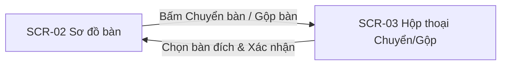
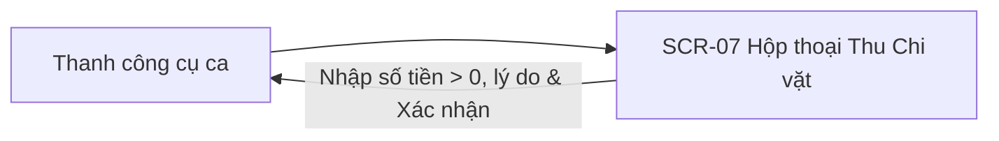

# POS Bán Hàng F&B (Quán Ăn, Cafe) — Luồng người dùng và danh mục màn hình

| Thông tin | Giá trị |
|---|---|
| Phiên bản | 0.1 · Nháp |
| Đầu vào | 04-usecases.md v0.1 · 05-userstories.md v0.1 |
| Wireframe | wireframes/pos-fnb.html |

## 1. Luồng người dùng

### 1.1 Luồng Mở ca làm việc (UC-01)

```mermaid
flowchart LR
    S1["SCR-01 Mở ca làm việc"] -->|Nhập số tiền đầu ca > 0| S2["SCR-02 Sơ đồ bàn"]
    S2 -->|Chưa mở ca cố gắng bán hàng (ERR-01)| S1
```

| Loại | Tình huống | Đi qua màn | Kết quả | Liên quan |
|---|---|---|---|---|
| Đúng | Thu ngân đăng nhập, nhập tiền mặt đầu ca 1000000 VNĐ | SCR-01 → SCR-02 | Ca mở thành công (DANG_MO), chuyển sang sơ đồ bàn | AC-01-1 |
| Lỗi | Thu ngân chưa mở ca nhưng cố tình truy cập màn bán hàng | SCR-02 → SCR-01 | Chặn và hiển thị lỗi ERR-01: "Ca làm việc chưa được mở. Vui lòng mở ca và nhập số dư tiền mặt đầu ca để bắt đầu." | ERR-01 · BR-01 |
| Biên | Nhập số tiền đầu ca bằng 0 VNĐ | SCR-01 → SCR-02 | Chấp nhận mở ca với két tiền rỗng 0 VNĐ | BR-01 |

### 1.2 Luồng Gọi món và Gửi bếp tại bàn (UC-02)

```mermaid
flowchart LR
    S2["SCR-02 Sơ đồ bàn"] -->|Chọn bàn trống| S2_Order["Màn gọi món tại bàn"]
    S2_Order -->|Bấm Gửi Bếp| S2_Print["In phiếu KOT LAN"]
    S2_Order -->|Chọn món hết hàng (ERR-07)| S2_Order
    S2_Print -->|Mất mạng máy in (ERR-06)| S2_Retry["Cảnh báo in lại"]
```

| Loại | Tình huống | Đi qua màn | Kết quả | Liên quan |
|---|---|---|---|---|
| Đúng | Chọn Bàn 01 (Trống), chọn món Cà phê sữa, ghi chú ít ngọt, bấm Gửi Bếp | SCR-02 | Bàn chuyển màu đỏ (Đang dùng), in KOT ra Bếp/Bar | AC-02-1 · AC-02-2 · AC-03-1 |
| Lỗi | Nhân viên chọn món đang ở trạng thái hết hàng | SCR-02 | Chặn thêm món, hiển thị ERR-07: "Món {ten_mon} hiện đã hết. Vui lòng chọn món khác!" | ERR-07 · BR-09 |
| Biên | Máy in Bếp mất kết nối LAN hoặc kẹt giấy khi bấm Gửi Bếp | SCR-02 | Đơn vẫn lưu, hiển thị cảnh báo ERR-06 kèm nút Thử in lại | ERR-06 |

### 1.3 Luồng Chuyển bàn và Gộp bàn (UC-03)



| Loại | Tình huống | Đi qua màn | Kết quả | Liên quan |
|---|---|---|---|---|
| Đúng | Chuyển toàn bộ 3 món từ Bàn 01 sang Bàn 05 đang trống | SCR-02 → SCR-03 → SCR-02 | Bàn 05 nhận 3 món và chuyển màu đỏ, Bàn 01 thành Trống | AC-04-1 |
| Đúng | Gộp Bàn 02 vào Bàn 01 đang phục vụ | SCR-02 → SCR-03 → SCR-02 | Món của 2 bàn gộp chung vào Bàn 01, Bàn 02 giải phóng thành Trống | AC-04-2 |
| Biên | Danh sách bàn trống không còn bàn nào | SCR-03 | Thông báo toàn bộ bàn đã kín, vô hiệu hóa nút Chuyển bàn | BR-02 |

### 1.4 Luồng Bán hàng nhanh tại quầy (UC-04)

```mermaid
flowchart LR
    S4["SCR-04 Bán tại quầy"] -->|Chọn món & Bấm Thanh toán| S6["SCR-06 Thanh toán"]
    S4 -->|Giỏ hàng rỗng bấm thanh toán (ERR-08)| S4
```

| Loại | Tình huống | Đi qua màn | Kết quả | Liên quan |
|---|---|---|---|---|
| Đúng | Khách order 1 Trà sữa mang về, chọn trả tiền mặt 35000 VNĐ | SCR-04 → SCR-06 | In hóa đơn và in phiếu nhận đồ có số thứ tự tăng dần | AC-05-1 |
| Lỗi | Thu ngân bấm nút Thanh toán khi giỏ hàng chưa có món nào | SCR-04 | Chặn và hiển thị lỗi ERR-08: "Đơn hàng chưa có món ăn. Vui lòng chọn món trước khi thanh toán!" | ERR-08 · BR-10 |

### 1.5 Luồng Xác thực mã PIN Quản lý (UC-05)

```mermaid
flowchart LR
    Action["Thao tác: Hủy món / Giảm giá / Xóa đơn"] --> S5["SCR-05 Hộp thoại mã PIN"]
    S5 -->|Nhập đúng PIN| Success["Áp dụng & In phiếu hủy KOT"]
    S5 -->|Nhập sai PIN (ERR-02)| S5
    S5 -->|Sai liên tiếp 5 lần (ERR-03)| Lock["Khóa xác thực 5 phút"]
```

| Loại | Tình huống | Đi qua màn | Kết quả | Liên quan |
|---|---|---|---|---|
| Đúng | Hủy món đã gửi bếp, nhập lý do "Khách đổi món", Quản lý nhập đúng PIN | SCR-05 | Xóa món khỏi đơn, in phiếu báo hủy xuống Bếp/Bar, ghi nhật ký | AC-06-1 · BR-03 |
| Lỗi | Quản lý nhập sai mã PIN | SCR-05 | Hiển thị lỗi ERR-02: "Mã PIN phê duyệt không chính xác. Vui lòng kiểm tra lại!" | ERR-02 · BR-04 |
| Lỗi | Nhập sai mã PIN liên tiếp 5 lần | SCR-05 | Hiển thị ERR-03: "Bạn đã nhập sai mã PIN quá 5 lần. Chức năng xác thực bị khóa tạm thời trong 5 phút!" | ERR-03 · BR-04 |

### 1.6 Luồng Thanh toán hóa đơn và VietQR (UC-06)

```mermaid
flowchart LR
    S2["SCR-02 Sơ đồ bàn"] -->|In tạm tính (Bàn vàng)| S6["SCR-06 Màn hình thanh toán"]
    S6 -->|Chọn Tiền mặt & Nhập tiền khách đưa| Done["In hóa đơn & Giải phóng bàn"]
    S6 -->|Chọn VietQR| QR["Hiển thị mã VietQR động"]
    QR -->|Quá 3 phút (ERR-09)| QR_Retry["Cảnh báo hết hạn"]
    Done -->|Máy in hết giấy (ERR-10)| Paper_Error["Cảnh báo hết giấy & In lại"]
```

| Loại | Tình huống | Đi qua màn | Kết quả | Liên quan |
|---|---|---|---|---|
| Đúng | Khách thanh toán hóa đơn 175000 VNĐ bằng tiền mặt 200000 VNĐ | SCR-06 | Hiển thị tiền thối 25000 VNĐ, in hóa đơn, bàn chuyển thành Trống | AC-07-1 · AC-07-2 |
| Đúng | Khách quét mã VietQR động thành công | SCR-06 | Cập nhật kênh thanh toán VIETQR, hoàn tất đơn, in hóa đơn | AC-08-1 · AC-08-2 |
| Lỗi | Mã VietQR động quá 3 phút khách chưa quét | SCR-06 | Hiển thị ERR-09: "Hết thời gian chờ thanh toán VietQR. Vui lòng tạo mã QR mới hoặc thanh toán tiền mặt!" | ERR-09 · BR-11 |
| Lỗi | Máy in hóa đơn bị kẹt giấy hoặc hết giấy khi in | SCR-06 | Đơn vẫn thanh toán xong, hiển thị ERR-10: "Máy in hóa đơn hết giấy hoặc bị kẹt. Vui lòng kiểm tra giấy và in lại!" | ERR-10 · BR-12 |

### 1.7 Luồng Ghi nhận Thu / Chi tiền mặt trong ca (UC-07)



| Loại | Tình huống | Đi qua màn | Kết quả | Liên quan |
|---|---|---|---|---|
| Đúng | Chi 50000 VNĐ mua đá khẩn cấp, ghi lý do chi tiết | SCR-07 | Tạo phiếu chi, tự động trừ 50000 VNĐ vào Tiền mặt lý thuyết | AC-09-1 · BR-05 |
| Đúng | Nạp thêm 200000 VNĐ tiền lẻ vào két | SCR-07 | Tạo phiếu thu, tự động cộng 200000 VNĐ vào Tiền mặt lý thuyết | AC-09-2 · BR-05 |

### 1.8 Luồng Kết ca và Kiểm kê tiền mặt (UC-08)

```mermaid
flowchart LR
    S2["Màn hình bán hàng"] -->|Bấm Kết ca| CheckTable{"Còn bàn chưa trả?"}
    CheckTable -- "Còn bàn (ERR-04)" --> S2
    CheckTable -- "Hết bàn" --> S8["SCR-08 Kiểm kê tiền cuối ca"]
    S8 -->|Khớp tiền| Sign["Quản lý nhập PIN ký duyệt"]
    S8 -->|Lệch tiền mà không nhập lý do (ERR-05)| S8
    Sign --> PrintZ["In biên bản Z-Report & Đăng xuất"]
```

| Loại | Tình huống | Đi qua màn | Kết quả | Liên quan |
|---|---|---|---|---|
| Đúng | Hết ca, mọi bàn đã thanh toán, đếm tiền khớp số sách, Quản lý nhập PIN | SCR-08 | Ca đóng (DA_DONG), in biên bản bàn giao ca Z-Report, khóa ca | AC-10-2 · BR-05 |
| Lỗi | Cố gắng kết ca khi vẫn còn bàn chưa thanh toán | SCR-08 | Chặn và hiển thị ERR-04: "Không thể đóng ca! Vẫn còn {so_luong_ban} bàn chưa hoàn tất thanh toán. Vui lòng thanh toán hoặc bàn giao bàn." | ERR-04 · BR-07 |
| Lỗi | Tiền thực tế lệch sổ sách mà bấm Xác nhận không nhập lý do | SCR-08 | Chặn và hiển thị ERR-05: "Tiền mặt thực tế bị lệch {so_tien_lech} VNĐ. Vui lòng nhập lý do giải trình để tiếp tục!" | ERR-05 · BR-06 |

### 1.9 Luồng Báo cáo doanh thu (UC-09) và Quản lý thực đơn (UC-10)

```mermaid
flowchart LR
    Nav["Menu Quản trị"] --> S9["SCR-09 Báo cáo doanh thu"]
    Nav --> S10["SCR-10 Quản lý thực đơn"]
    S9 -->|Ngày bắt đầu > Ngày kết thúc (ERR-11)| S9
    S10 -->|Nhập đơn giá âm (ERR-12)| S10
```

| Loại | Tình huống | Đi qua màn | Kết quả | Liên quan |
|---|---|---|---|---|
| Đúng | Quản lý xem báo cáo doanh thu ngày hôm nay | SCR-09 | Hiển thị tổng doanh thu, tỷ trọng Tiền mặt vs VietQR, doanh thu theo ca | AC-11-1 |
| Lỗi | Chọn khoảng ngày lọc báo cáo: ngày bắt đầu lớn hơn ngày kết thúc | SCR-09 | Hiển thị lỗi ERR-11: "Ngày bắt đầu không được lớn hơn ngày kết thúc!" | ERR-11 · BR-13 |
| Đúng | Quản lý bấm tắt bán món Trà sữa matcha | SCR-10 | Trạng thái món chuyển sang HET_HANG, POS không cho phục vụ gọi món này | AC-12-1 · BR-09 |
| Lỗi | Quản lý nhập đơn giá món ăn nhỏ hơn 0 VNĐ | SCR-10 | Chặn lưu và hiển thị ERR-12: "Đơn giá món ăn không được nhỏ hơn 0 VNĐ!" | ERR-12 · BR-14 |

---

## 2. Danh mục màn hình

| ID | Màn hình | Tác nhân | Mục đích | Luồng | Yêu cầu | Trạng thái |
|---|---|---|---|---|---|---|
| SCR-01 | Màn hình Mở ca làm việc | Thu ngân | Nhập số dư tiền lẻ đầu ca trong két để mở phiên bán hàng | UC-01 | FR-06 | Phác |
| SCR-02 | Màn hình Sơ đồ bàn & Gọi món tại bàn | Nhân viên phục vụ, Thu ngân | Xem trạng thái bàn, chọn món, thêm topping, ghi chú và gửi bếp | UC-02 | FR-01, FR-02, FR-03 | Phác |
| SCR-03 | Hộp thoại Chuyển bàn và Gộp bàn | Nhân viên phục vụ, Thu ngân | Chọn bàn nguồn và bàn đích để chuyển hoặc sáp nhập hóa đơn | UC-03 | FR-01, FR-04 | Phác |
| SCR-04 | Màn hình Bán tại quầy / Mang về | Thu ngân | Thao tác chọn món nhanh, in số thứ tự và thu tiền tại chỗ | UC-04 | FR-05, FR-11 | Phác |
| SCR-05 | Hộp thoại Xác thực mã PIN Quản lý | Chủ quán / Quản lý | Nhập mã PIN 4-6 số và lý do để duyệt hủy món, chiết khấu, xóa bill | UC-05 | FR-10 | Phác |
| SCR-06 | Màn hình Thanh toán & Hiển thị VietQR | Thu ngân, Khách hàng | Hiển thị tạm tính, tiền thối tiền mặt hoặc mã VietQR động | UC-06 | FR-11, FR-12, FR-13 | Phác |
| SCR-07 | Hộp thoại Thu / Chi tiền mặt trong ca | Thu ngân | Ghi nhận các khoản nạp rút tiền mặt khẩn cấp trong ca | UC-07 | FR-07 | Phác |
| SCR-08 | Màn hình Kết ca & Kiểm đếm két tiền | Thu ngân, Chủ quán / Quản lý | Kiểm đếm tiền mặt thực tế, so khớp độ lệch và ký duyệt Z-Report | UC-08 | FR-08, FR-09 | Phác |
| SCR-09 | Màn hình Báo cáo doanh thu & Thống kê | Chủ quán / Quản lý | Xem biểu đồ doanh thu, cơ cấu thanh toán, ca làm và top món hot | UC-09 | FR-14 | Phác |
| SCR-10 | Màn hình Quản lý thực đơn & Trạng thái món | Chủ quán / Quản lý | Thiết lập danh mục món, giá bán và bật tắt trạng thái hết món tức thời | UC-10 | FR-15 | Phác |

---

## 3. Mô tả control từng màn

### Control của SCR-01 Màn hình Mở ca làm việc

| # | Thành phần | Kiểu control | Kiểu dữ liệu / ràng buộc | Mô tả và hành vi | Liên quan |
|---|---|---|---|---|---|
| 1 | Tiêu đề ca & Ngày giờ | Nhãn văn bản | Chuỗi(50), định dạng ngày giờ GMT+7 | Hiển thị tên thu ngân đăng nhập và thời gian mở ca | FR-06 |
| 2 | Ô nhập Tiền mặt đầu ca | Ô nhập số | Tiền (VND), bắt buộc, lớn hơn hoặc bằng 0 | Nhập số tiền mặt có sẵn trong két để thối tiền lẻ | FR-06 · BR-01 |
| 3 | Nút Xác nhận mở ca | Nút bấm chính | Nút bấm nổi bật | Bấm để kích hoạt ca làm việc và chuyển sang sơ đồ bàn | FR-06 |
| 4 | Khu vực thông báo lỗi | Nhãn cảnh báo | Chuỗi hiển thị lỗi | Hiển thị ERR-01 nếu cố tình bán hàng khi chưa mở ca | ERR-01 |

### Control của SCR-02 Màn hình Sơ đồ bàn & Gọi món tại bàn

| # | Thành phần | Kiểu control | Kiểu dữ liệu / ràng buộc | Mô tả và hành vi | Liên quan |
|---|---|---|---|---|---|
| 1 | Tab Khu vực phòng bàn | Danh sách tab chọn | Chuỗi, ví dụ: Tầng 1, Tầng 2, Sân vườn | Lọc danh sách bàn theo từng khu vực quán | FR-01 |
| 2 | Lưới ô Bàn ăn | Danh sách thẻ nút | Mã bàn, tên bàn, màu sắc theo trạng thái | Bàn Trống (xanh lá), Đang phục vụ (đỏ), Chờ tính tiền (vàng) | FR-01 · BR-02 |
| 3 | Danh mục nhóm món | Danh sách cuộn ngang | Nhóm món: Cà phê, Trà sữa, Món ăn vặt... | Lọc danh sách món ăn theo phân loại thực đơn | FR-02 |
| 4 | Danh sách món ăn | Lưới thẻ món | Tên món, đơn giá, ảnh, nhãn Hết hàng | Bấm vào món để thêm vào giỏ hàng bàn | FR-02 · BR-09 |
| 5 | Danh sách chi tiết order | Bảng giỏ hàng | Tên món, số lượng (+/-), đơn giá, topping, ghi chú | Hiển thị các món đã chọn của bàn hiện tại | FR-02 |
| 6 | Nút Gửi Bếp | Nút bấm chính | Kích hoạt in KOT | Lưu đơn, chuyển bàn sang màu đỏ, in phiếu chế biến qua LAN | FR-03 · ERR-06 |
| 7 | Nút Chuyển/Gộp bàn | Nút bấm phụ | Mở hộp thoại SCR-03 | Cho phép chọn đổi bàn hoặc gộp bàn | FR-04 |
| 8 | Nút In tạm tính | Nút bấm phụ | Mở màn hình SCR-06 | In phiếu tạm tính và chuyển bàn sang màu vàng | FR-13 |

### Control của SCR-03 Hộp thoại Chuyển bàn và Gộp bàn

| # | Thành phần | Kiểu control | Kiểu dữ liệu / ràng buộc | Mô tả và hành vi | Liên quan |
|---|---|---|---|---|---|
| 1 | Chọn loại thao tác | Nút chuyển đổi (Toggle) | Một trong: Chuyển bàn \| Gộp bàn | Xác định chế độ chuyển toàn bộ hay sáp nhập món | FR-04 |
| 2 | Bàn nguồn hiện tại | Nhãn văn bản | Tên bàn đang phục vụ, ví dụ: Bàn 01 | Cố định bàn đang mở thao tác | FR-04 |
| 3 | Danh sách bàn đích | Hộp thả chọn hoặc lưới bàn | Bàn trống (nếu chuyển) hoặc Bàn đang dùng (nếu gộp) | Chọn bàn nhận món | FR-04 · BR-02 |
| 4 | Nút Xác nhận chuyển/gộp | Nút bấm chính | Thực hiện lệnh | Hoàn tất chuyển hoặc gộp, cập nhật sơ đồ bàn | FR-04 |

### Control của SCR-04 Màn hình Bán tại quầy / Mang về

| # | Thành phần | Kiểu control | Kiểu dữ liệu / ràng buộc | Mô tả và hành vi | Liên quan |
|---|---|---|---|---|---|
| 1 | Ô tìm kiếm món nhanh | Ô nhập văn bản | Chuỗi tìm kiếm theo tên món hoặc mã món | Tìm nhanh món ăn/đồ uống khi khách đông | FR-05 |
| 2 | Danh sách thực đơn chạm | Lưới thẻ món lớn | Tên món, đơn giá, phân loại | Chạm nhanh để thêm vào đơn mang về | FR-05 |
| 3 | Giỏ hàng tại quầy | Bảng danh sách món | Danh sách món, số lượng, tổng tiền | Hiển thị các món khách mua mang đi | FR-05 · BR-10 |
| 4 | Nút Thanh toán nhanh | Nút bấm chính | Mở màn hình SCR-06 | Chặn nếu giỏ hàng rỗng (báo ERR-08) | FR-05 · ERR-08 |

### Control của SCR-05 Hộp thoại Xác thực mã PIN Quản lý

| # | Thành phần | Kiểu control | Kiểu dữ liệu / ràng buộc | Mô tả và hành vi | Liên quan |
|---|---|---|---|---|---|
| 1 | Tiêu đề hành động nhạy cảm | Nhãn văn bản | Tên hành động: Hủy món, Giảm giá, Hủy hóa đơn | Báo rõ thao tác nào đang yêu cầu quyền Quản lý | FR-10 |
| 2 | Ô nhập lý do thao tác | Ô nhập văn bản | Chuỗi(255), tối thiểu 5 ký tự | Ghi nhận nguyên nhân (ví dụ: Khách đổi món, Khách quen giảm giá) | FR-10 · BR-03 |
| 3 | Bàn phím số nhập mã PIN | Bàn phím số cảm ứng | 4 đến 6 chữ số, ẩn ký tự bằng dấu chấm | Quản lý nhập mã PIN bí mật | FR-10 · BR-04 |
| 4 | Nút Xác nhận phê duyệt | Nút bấm chính | Kiểm tra mã PIN | Kiểm tra PIN, báo ERR-02 nếu sai, khóa 5 phút nếu sai 5 lần (ERR-03) | FR-10 · ERR-02 · ERR-03 |

### Control của SCR-06 Màn hình Thanh toán & Hiển thị VietQR

| # | Thành phần | Kiểu control | Kiểu dữ liệu / ràng buộc | Mô tả và hành vi | Liên quan |
|---|---|---|---|---|---|
| 1 | Bảng kê chi tiết thanh toán | Bảng tóm tắt | Tổng tiền hàng, Giảm giá, Khách cần trả | Hiển thị số tiền chuẩn xác của hóa đơn | FR-11, FR-13 |
| 2 | Nút chọn Phương thức | Nút chọn tab | Tiền mặt hoặc Quét mã VietQR | Chuyển đổi giữa 2 hình thức thanh toán | FR-11, FR-12 |
| 3 | Khung Tiền mặt | Khối nhập số & gợi ý | Tiền khách đưa (gợi ý mệnh giá 50k, 100k, 200k, 500k), Tiền thối lại | Tự động tính tiền thối lại cho khách | FR-11 |
| 4 | Khung mã VietQR động | Vùng hiển thị ảnh QR | Mã VietQR chuẩn NAPAS247 kèm bộ đếm ngược 3 phút | Hiển thị QR chứa số tiền và mã hóa đơn cho khách quét | FR-12 · BR-11 · ERR-09 |
| 5 | Nút Hoàn tất thanh toán | Nút bấm chính | Ghi nhận hóa đơn đã thanh toán | Lưu đơn, cập nhật ca, giải phóng bàn và in hóa đơn (báo ERR-10 nếu hết giấy) | FR-11 · FR-13 · ERR-10 |

### Control của SCR-07 Hộp thoại Thu / Chi tiền mặt trong ca

| # | Thành phần | Kiểu control | Kiểu dữ liệu / ràng buộc | Mô tả và hành vi | Liên quan |
|---|---|---|---|---|---|
| 1 | Lựa chọn loại phiếu | Nút chuyển đổi (Toggle) | Một trong: Thu tiền mặt \| Chi tiền mặt | Phân định khoản nạp thêm hay chi ra | FR-07 |
| 2 | Ô nhập số tiền | Ô nhập số | Tiền (VND), lớn hơn 0 | Số tiền mặt thực tế giao dịch | FR-07 · BR-05 |
| 3 | Ô nhập lý do chi tiết | Ô nhập văn bản | Chuỗi(255), bắt buộc | Ghi rõ mục đích (Mua đá, mua nguyên liệu, nạp tiền lẻ) | FR-07 |
| 4 | Nút Xác nhận tạo phiếu | Nút bấm chính | Cập nhật sổ tiền mặt | Lưu phiếu và cập nhật Tiền mặt lý thuyết của ca | FR-07 · BR-05 |

### Control của SCR-08 Màn hình Kết ca & Kiểm đếm két tiền

| # | Thành phần | Kiểu control | Kiểu dữ liệu / ràng buộc | Mô tả và hành vi | Liên quan |
|---|---|---|---|---|---|
| 1 | Thống kê doanh thu ca | Bảng tóm tắt | Tiền đầu ca, Doanh thu tiền mặt, Doanh thu VietQR, Thu/Chi vặt, Tiền mặt lý thuyết | Tổng hợp toàn bộ số liệu tài chính trong phiên làm việc | FR-08 · BR-05 |
| 2 | Ô nhập Tiền thực đếm | Ô nhập số | Tiền (VND), lớn hơn hoặc bằng 0 | Thu ngân nhập tổng số tiền mặt đếm được trong két | FR-08 |
| 3 | Nhãn hiển thị Độ lệch | Nhãn màu cảnh báo | Độ lệch = Thực tế - Lý thuyết | Khớp tiền (xanh lá 0đ), Thừa tiền (+), Thiếu tiền (-) | FR-08 · BR-06 |
| 4 | Ô nhập Ghi chú giải trình | Ô nhập văn bản | Chuỗi(255), bắt buộc nếu độ lệch khác 0 | Giải trình nguyên nhân thừa/thiếu tiền (báo ERR-05 nếu bỏ trống) | FR-08 · BR-06 · ERR-05 |
| 5 | Ô nhập PIN Quản lý ký duyệt | Bàn phím số mã PIN | 4 đến 6 chữ số | Quản lý đồng kiểm đếm và ký xác nhận đóng ca | FR-09 |
| 6 | Nút Ký duyệt & Đóng ca | Nút bấm chính | Khóa ca và in Z-Report | Đóng ca, in biên bản bàn giao Z-Report và đăng xuất | FR-09 |

### Control của SCR-09 Màn hình Báo cáo doanh thu & Thống kê

| # | Thành phần | Kiểu control | Kiểu dữ liệu / ràng buộc | Mô tả và hành vi | Liên quan |
|---|---|---|---|---|---|
| 1 | Bộ lọc khoảng thời gian | Hộp chọn ngày & nút nhanh | Hôm nay, Hôm qua, 7 ngày, Từ ngày đến ngày | Lọc báo cáo (báo ERR-11 nếu ngày bắt đầu > ngày kết thúc) | FR-14 · BR-13 · ERR-11 |
| 2 | Thẻ chỉ số tổng quan | Thẻ số liệu lớn | Tổng doanh thu thuần, Tổng số đơn, Giá trị đơn trung bình | Nắm bắt nhanh tình hình kinh doanh | FR-14 |
| 3 | Biểu đồ tỷ trọng thanh toán | Biểu đồ tròn (Pie chart) | Tỷ lệ % Tiền mặt vs Chuyển khoản VietQR | Theo dõi cơ cấu dòng tiền thanh toán | FR-14 |
| 4 | Bảng doanh thu theo ca | Bảng dữ liệu | Mã ca, Thu ngân, Giờ mở/đóng, Doanh thu, Độ lệch tiền | Chi tiết từng phiên làm việc của nhân viên | FR-14 |
| 5 | Bảng top món bán chạy | Bảng xếp hạng | Tên món, Số lượng bán, Doanh thu món | Biết món nào được khách ưa chuộng nhất | FR-14 |

### Control của SCR-10 Màn hình Quản lý thực đơn & Trạng thái món

| # | Thành phần | Kiểu control | Kiểu dữ liệu / ràng buộc | Mô tả và hành vi | Liên quan |
|---|---|---|---|---|---|
| 1 | Cây danh mục nhóm món | Danh sách chọn | Danh mục: Cà phê, Trà sữa, Nước ép, Điểm tâm | Phân nhóm món ăn thức uống | FR-15 |
| 2 | Bảng danh sách món | Bảng dữ liệu có nút sửa | Mã món, Tên món, Đơn giá, Trạng thái (Đang bán / Hết hàng) | Hiển thị toàn bộ thực đơn quán | FR-15 |
| 3 | Nút gạt bật/tắt Hết hàng | Nút gạt trạng thái (Switch) | Đang bán hoặc Hết hàng | Bấm để đổi trạng thái hết món tức thời trên màn hình POS | FR-15 · BR-09 |
| 4 | Form thêm/sửa món ăn | Hộp thoại nhập liệu | Tên món, Đơn giá (>= 0 VNĐ), Ảnh, Nhóm món | Nhập thông tin món mới (báo ERR-12 nếu giá âm) | FR-15 · BR-14 · ERR-12 |

---

## 4. Câu hỏi còn mở

*(Không có câu hỏi mở mới nào phát sinh ở bước thiết kế màn hình)*

## Lịch sử thay đổi

| Phiên bản | Ngày | Thay đổi | Nguồn |
|---|---|---|---|
| 0.1 | 2026-10-20 | Khởi tạo tài liệu luồng người dùng và đặc tả chi tiết control 10 màn hình SCR-01 đến SCR-10 | 04-usecases.md · 05-userstories.md |
