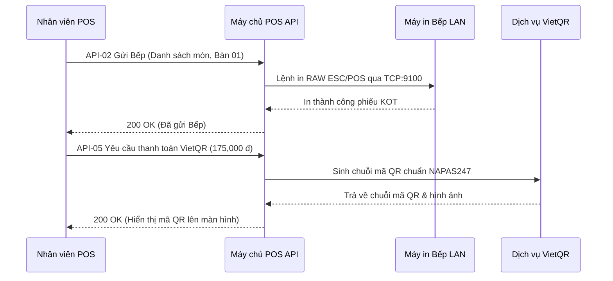

# POS Bán Hàng F&B (Quán Ăn, Cafe) — Đặc tả tích hợp API

| Thông tin | Giá trị |
|---|---|
| Phiên bản | 0.1 · Nháp |
| Đầu vào | 03-srs.md v0.1 · Chuẩn VietQR NAPAS247 & Giao thức máy in nhiệt ESC/POS |
| Hướng | Hai chiều (Hệ thống gọi máy in LAN, sinh mã VietQR và API nội bộ cho POS) |

## 1. Đánh giá đối tác hoặc phương án

| Tiêu chí | Cổng thanh toán VietQR (NAPAS247) | Máy in nhiệt mạng LAN (ESC/POS) | Tự xây |
|---|---|---|---|
| Đáp ứng FR | Đáp ứng đầy đủ FR-12 (Tạo mã QR động chứa số tiền và mã hóa đơn) | Đáp ứng đầy đủ FR-03, FR-13 (In lệnh chế biến KOT và hóa đơn nhiệt) | Tự xây backend REST API kết nối thiết bị |
| Chi phí | Miễn phí theo chuẩn VietQR của ngân hàng | Chi phí mua máy in LAN chuẩn 80mm thông dụng | Chi phí phát triển phần mềm |
| Giới hạn tốc độ, SLA | Phản hồi sinh mã QR tức thời dưới 1 giây; phụ thuộc mạng ngân hàng | In qua mạng LAN cục bộ dưới 2.5 giây, không phụ thuộc Internet | Phản hồi dưới 0.5 giây trong mạng LAN |
| Bảo mật, nơi lưu dữ liệu | Chuỗi QR sinh theo thuật toán CRC16 chuẩn EMVCo, không lộ thông tin thẻ | Giao thức TCP Socket nội bộ qua cổng 9100, an toàn trong mạng LAN quán | Dữ liệu lưu trữ máy chủ cục bộ hoặc đám mây |
| Kết luận | Dùng chuẩn VietQR động kết hợp kiểm tra xác nhận | Dùng chuẩn máy in nhiệt ESC/POS qua cổng mạng LAN | Xây dựng REST API chuẩn OpenAPI 3.0 |

## 2. Tóm tắt tài liệu API của đối tác

- Xác thực API: Sử dụng Bearer Token (JSON Web Token - JWT) trong tiêu đề Authorization cho toàn bộ API ứng dụng POS.
- Biến môi trường hệ thống:
  - VIETQR_BANK_BIN: Mã định danh ngân hàng quán (ví dụ: 970422 cho MBBank, 970436 cho Vietcombank).
  - VIETQR_ACCOUNT_NO: Số tài khoản ngân hàng thụ hưởng của quán ăn, cafe.
  - PRINTER_KITCHEN_IP: Địa chỉ IP máy in Bếp/Bar trong mạng LAN (mặc định cổng 9100).
- Giới hạn tốc độ: Hệ thống POS phục vụ giờ cao điểm tối đa 30 request/giây trên mạng nội bộ LAN.
- Múi giờ và tiền tệ: Múi giờ Việt Nam GMT+7; toàn bộ số tiền giao dịch tính bằng Việt Nam Đồng (VND), không có phần thập phân.

## 3. Luồng tích hợp

## 4. Danh mục endpoint

| ID | Method | Path | Mục đích | Xác thực | Mã thành công | Yêu cầu |
|---|---|---|---|---|---|---|
| API-01 | POST | /api/v1/shifts/open | Mở ca làm việc mới và ghi nhận tiền lẻ đầu ca trong két | Bearer | 201 | FR-06 |
| API-02 | POST | /api/v1/orders/kitchen-print | Gửi danh sách món và phát lệnh in phiếu chế biến KOT xuống Bếp/Bar | Bearer | 200 | FR-03 |
| API-03 | POST | /api/v1/tables/transfer | Điều chuyển toàn bộ món từ bàn này sang bàn khác hoặc gộp bàn | Bearer | 200 | FR-04 |
| API-04 | POST | /api/v1/auth/verify-pin | Xác thực mã PIN Quản lý cho các thao tác nhạy cảm (hủy món, giảm giá) | Bearer | 200 | FR-10 |
| API-05 | POST | /api/v1/payments/vietqr | Tạo mã VietQR động chứa số tiền thanh toán và mã hóa đơn | Bearer | 200 | FR-12 |
| API-06 | POST | /api/v1/payments/cash | Xác nhận thanh toán tiền mặt và phát lệnh in hóa đơn hoàn tất | Bearer | 200 | FR-11, FR-13 |
| API-07 | POST | /api/v1/shifts/cash-transaction | Ghi nhận khoản nạp thêm hoặc chi trả tiền mặt khẩn cấp trong ca (Cash In/Out) | Bearer | 201 | FR-07 |
| API-08 | POST | /api/v1/shifts/close | Kết ca làm việc, kiểm kê tiền thực đếm và Quản lý ký duyệt Z-Report | Bearer | 200 | FR-08, FR-09 |
| API-09 | GET | /api/v1/reports/revenue | Tra cứu báo cáo doanh thu theo ca, theo phương thức thanh toán và top món | Bearer | 200 | FR-14 |

## 5. Ánh xạ trường: màn hình, dữ liệu hệ thống, API

| Màn hình (SCR / control) | Dữ liệu hệ thống (thực thể.thuộc tính) | API (endpoint.trường) | Chuyển đổi | Bắt buộc |
|---|---|---|---|---|
| SCR-01 #2 Ô nhập Tiền đầu ca | CaLamViec.TienDauCa | API-01 body.tienDauCa | Số nguyên VND | Có |
| SCR-02 #5 Giỏ hàng món ăn | ChiTietHoaDon.SoLuong | API-02 body.items.soLuong | Số nguyên | Có |
| SCR-02 #5 Giỏ hàng món ăn | ChiTietHoaDon.GhiChu | API-02 body.items.ghiChu | Chuỗi | Không |
| SCR-03 #2 Bàn nguồn hiện tại | BanAn.MaBan | API-03 body.banNguonId | Chuỗi mã bàn | Có |
| SCR-03 #3 Danh sách bàn đích | BanAn.MaBan | API-03 body.banDichId | Chuỗi mã bàn | Có |
| SCR-05 #3 Mã PIN Quản lý | CaLamViec.MaCa | API-04 body.pinCode | Chuỗi số 4-6 ký tự | Có |
| SCR-05 #2 Ô nhập lý do hủy | ChiTietHoaDon.LyDoHuy | API-04 body.lyDo | Chuỗi tối thiểu 5 ký tự | Có |
| SCR-06 #1 Khách cần trả | HoaDon.KhachCanTra | API-05 body.soTien | Số nguyên VND | Có |
| SCR-06 #1 Mã hóa đơn thanh toán | HoaDon.MaHoaDon | API-05 body.maHoaDon | Chuỗi mã hóa đơn | Có |
| SCR-06 #3 Tiền khách đưa | HoaDon.KhachCanTra | API-06 body.tienKhachDua | Số nguyên VND | Có |
| SCR-07 #2 Số tiền thu chi vặt | PhieuThuChi.SoTien | API-07 body.soTien | Số nguyên VND | Có |
| SCR-07 #3 Lý do thu chi chi tiết | PhieuThuChi.LyDo | API-07 body.lyDo | Chuỗi mô tả lý do | Có |
| SCR-08 #2 Tiền mặt thực đếm | CaLamViec.TienCuoiCaThucTe | API-08 body.tienThucDem | Số nguyên VND | Có |
| SCR-08 #4 Ghi chú giải trình | CaLamViec.GiaiTrinh | API-08 body.giaiTrinh | Bắt buộc nếu có chênh lệch | Không |
| SCR-09 #1 Bộ lọc ngày bắt đầu | CaLamViec.GioMo | API-09 query.fromDate | Định dạng YYYY-MM-DD | Có |
| SCR-09 #1 Bộ lọc ngày kết thúc | CaLamViec.GioDong | API-09 query.toDate | Định dạng YYYY-MM-DD | Có |

## 6. Lỗi từ đối tác

| Mã đối tác | Ý nghĩa | Hệ thống xử lý thế nào | Người dùng thấy | Liên quan |
|---|---|---|---|---|
| 503 | Máy in Bếp/Bar LAN mất kết nối hoặc kẹt giấy | Ghi log hệ thống, giữ nguyên đơn hàng và cho phép thử in lại | ERR-06 | API-02 |
| 504 | Cổng VietQR quá hạn thời gian chờ | Hủy mã QR cũ và cho phép tạo mã mới hoặc đổi sang tiền mặt | ERR-09 | API-05 |
| 500 | Máy in hóa đơn bị kẹt giấy hoặc hết giấy | Đánh dấu đơn đã thanh toán thành công và kích hoạt nút In lại | ERR-10 | API-06 |
| 403 | Mã PIN Quản lý không chính xác | Tăng bộ đếm số lần sai liên tiếp của tài khoản | ERR-02 | API-04 |
| 429 | Mã PIN bị khóa tạm thời do sai 5 lần | Chặn toàn bộ thao tác xác thực PIN trong vòng 5 phút | ERR-03 | API-04 |
| 409 | Còn bàn ăn chưa thanh toán khi đóng ca | Chặn đóng ca và yêu cầu thanh toán hết các bàn | ERR-04 | API-08 |
| 422 | Tiền mặt kết ca bị lệch mà thiếu giải trình | Chặn đóng ca và yêu cầu nhập lý do giải trình | ERR-05 | API-08 |

## 7. Cổng sẵn sàng lên production

- [ ] Cấu hình thông tin tài khoản ngân hàng và mã BIN trong file cấu hình môi trường hệ thống.
- [ ] Đã kiểm tra kết nối mạng LAN tới các địa chỉ IP máy in nhiệt Bếp và Quầy thu ngân.
- [ ] Đã chạy kiểm thử tự động toàn bộ 9 endpoint qua OpenAPI và Postman collection.
- [ ] Kịch bản mất mạng Internet đã được thử nghiệm (chuyển sang bán hàng offline và dùng mã VietQR tĩnh).
- [ ] Quy trình bàn giao Z-Report và khóa ca đã được quản lý quán nghiệm thu thực tế.

## 8. Câu hỏi còn mở

*(Không có câu hỏi mở mới về tích hợp API; cấu hình IP máy in và tài khoản ngân hàng do quán tự thiết lập trong file cấu hình môi trường khi triển khai)*

## Lịch sử thay đổi

| Phiên bản | Ngày | Thay đổi | Nguồn |
|---|---|---|---|
| 0.1 | 2026-10-20 | Khởi tạo tài liệu đặc tả 9 endpoint API, ma trận ánh xạ trường và xử lý lỗi đối tác | 03-srs.md · 08-screens.md |
